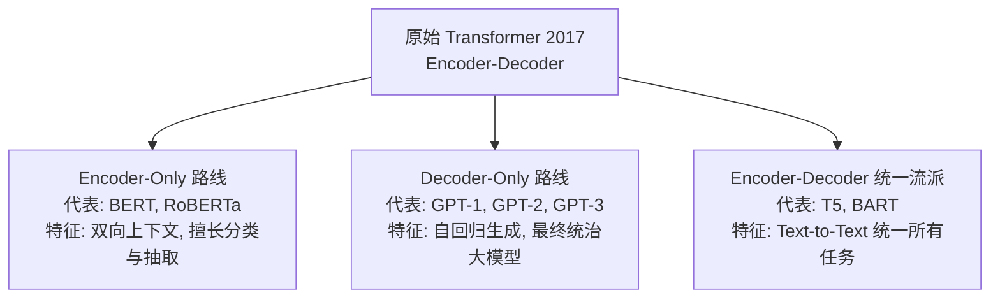

# 第一章：起源与基石 (2017 - 2019) —— 从注意力机制到预训练范式

> **核心主题**：序列建模范式革命、自注意力机制、Decoder-only vs Encoder-only 之争、无监督预训练。

---

## 1. 历史背景：Seq2Seq 与循环神经网络的困境

在 2017 年之前，自然语言处理（NLP）领域的核心支柱是以 **RNN（循环神经网络）**、**LSTM（长短期记忆网络）** 和 **GRU（门控循环单元）** 为代表的递归序列模型。

这类架构的核心特征是 **隐状态（Hidden State）的串行递推传递**：

$$h_t = f(h_{t-1}, x_t)$$

这种设计带来两个几乎无法逾越的技术瓶颈：

1. **无法充分并行计算（Sequential Computation Barrier）**：由于第 $t$ 步的计算强依赖于第 $t-1$ 步的输出，在 GPU 等大规模并行加速器上无法实现针对整个序列的并行计算，极大地限制了训练吞吐量和模型规模。
2. **长程依赖信息丢失（Long-range Vanishing Gradient）**：即便 LSTM 引入了门控机制，当文本序列长度超过数百个 token 时，初始位置的语义信号经过数十次矩阵连乘后仍然会严重衰减或失真，即所谓的“长距离遗忘”。

虽然 Bahdanau 等人在 2014 年引入了注意力机制（Attention Mechanism）作为 RNN 的辅助组件，但彼时的 Attention 仅仅被用作 Decoder 在每个解码步对 Encoder 各隐藏状态进行加权求和的外挂插件，计算骨架依然是串行的 RNN。

---

## 2. 划时代突破：Transformer 与《Attention Is All You Need》 (2017.06)

2017 年 6 月，Google 团队（Ashish Vaswani, Noam Shazeer, Niki Parmar 等 8 位作者）发表论文 **《Attention Is All You Need》**，彻底抛弃了循环与卷积结构，提出了纯粹依赖自注意力机制（Self-Attention）的 **Transformer** 架构。

### 2.1 核心数学原理：缩放点积注意力 (Scaled Dot-Product Attention)

Transformer 将输入映射为三个矩阵：Query ($Q$)、Key ($K$)、Value ($V$)。自注意力计算公式为：

$$\text{Attention}(Q, K, V) = \text{softmax}\left(\frac{QK^T}{\sqrt{d_k}}\right)V$$

- **为什么除以 $\sqrt{d_k}$？**：当向量维度 $d_k$ 很大时，点积结果的量级增大，会将 Softmax 函数推入梯度极小的饱和区（Vanishing Gradient）。通过除以 $\sqrt{d_k}$，将点积方差归一化到 1，保证了反向传播梯度的稳定性。
- **时间与空间复杂度**：由于需要计算 $Q$ 与 $K^T$ 的矩阵乘法，全注意力机制的时空复杂度为 $\mathcal{O}(N^2)$（$N$ 为序列长度）。这成为后续大模型扩展到长上下文（Long-Context）的核心瓶颈与优化方向。

### 2.2 多头注意力机制 (Multi-Head Attention, MHA)

$$\text{MultiHead}(Q, K, V) = \text{Concat}(\text{head}_1, \dots, \text{head}_h)W^O$$
$$\text{head}_i = \text{Attention}(QW_i^Q, KW_i^K, VW_i^V)$$

多头机制允许模型在不同的表示子空间中联合关注来自不同位置的上下文信息（例如一个头关注语法依存关系，另一个头关注代词指代消歧），极大增强了特征表达的丰富性。

### 2.3 位置编码 (Positional Encoding)

由于自注意力机制具备天然的置换不变性（Permutation Invariance），模型本身无法感知 token 的顺序。原始 Transformer 采用了基于三角函数的固定绝对位置编码：

$$PE_{(pos, 2i)} = \sin\left(\frac{pos}{10000^{2i/d_{\text{model}}}}\right)$$
$$PE_{(pos, 2i+1)} = \cos\left(\frac{pos}{10000^{2i/d_{\text{model}}}}\right)$$

*(注：后续发展出了可学习位置编码、RoPE 旋转位置编码、ALiBi 等，成为大模型演进的关键一环。)*

---

## 3. 分道扬镳：三大流派与预训练范式的建立

原始 Transformer 是一个标准的 **Encoder-Decoder** 架构（专为机器翻译设计）。随着 NLP 社区对预训练任务探索的深入，研究界迅速分裂为三大路线：

### 3.1 OpenAI GPT-1 (2018.06)：生成式自回归预训练的开端

- **论文**：《Improving Language Understanding by Generative Pre-Training》(Alec Radford, Ilya Sutskever 等)
- **核心动机**：摆脱深度学习对大规模手工标注数据的依赖，利用海量无标注文本进行生成式预训练，然后针对特定下游任务进行微调（Fine-Tuning）。
- **架构选择**：**Decoder-Only**（12 层 Transformer Decoder，1.17 亿参数）。
- **训练目标**：标准的自回归自左向右语言建模目标（Causal Language Modeling, CLM）：

$$L_1(\mathcal{U}) = \sum_{i} \log P(u_i \mid u_{i-k}, \dots, u_{i-1}; \Theta)$$

- **历史意义**：验证了“自回归无监督预训练 + 有监督微调”的可行性，确定了 OpenAI 坚守 Decoder-only 路线的战略定力。

### 3.2 Google BERT (2018.10)：双向理解的巅峰与暂时性统治

- **论文**：《BERT: Pre-training of Deep Bidirectional Transformers for Language Understanding》(Jacob Devlin 等)
- **核心动机**：GPT-1 的因果掩码阻隔了来自未来的信息流，而句意理解任务（如情感分析、命名实体识别、自然语言推理）需要真正的双向上下文信息。
- **架构选择**：**Encoder-Only**（BERT-Base: 110M 参数，BERT-Large: 340M 参数）。
- **训练目标**：
  1. **Masked Language Model (MLM)**：随机掩盖 15% 的 token，让模型利用双向上下文预测被遮盖词（完形填空机制）。
  2. **Next Sentence Prediction (NSP)**：预测句子 B 是否为句子 A 的下一句。
- **历史影响**：在 GLUE 基准上刷新全部 11 项记录。BERT 的爆炸性成功使得整个 NLP 学术界和工业界在 2018-2020 年间大量涌向 Encoder-only 路线（衍生出 RoBERTa, ALBERT, ELECTRA 等）。然而，Encoder 架构的天然局限在于**不擅长开放式文本生成**，这为后来的生成式大模型范式交替埋下了伏笔。

### 3.3 OpenAI GPT-2 (2019.02)：Zero-Shot 与无监督多任务学习假说

- **论文**：《Language Models are Unsupervised Multitask Learners》
- **核心动机**：模型必须针对下游任务微调（Fine-tuning）依然不够优雅。能否让模型不进行任何参数微调，仅仅通过给定的提示（Prompt / Context），直接零样本（Zero-Shot）完成任意任务？
- **规模升级**：最大版本参数量达到 **15 亿（1.5B）**，采用 WebText 数据集（包含 800 万篇 Reddit 高赞链接网页文本）。
- **架构改进**：将 Layer Normalization 移至每个子块的输入端（Pre-LN 设计，对稳定大模型训练至关重要），在最终自注意力块后增加一层 LayerNorm。
- **争议与警钟**：OpenAI 以“潜在的滥用风险（大规模自动生成虚假新闻）”为由，实行分阶段逐步开源策略，引发了开源社区和媒体的巨大争议，也首次向世界敲响了 AI 安全与生成滥用的警钟。

### 3.4 Google T5 (2019.10)：Text-to-Text 的终极大一统

- **论文**：《Exploring the Limits of Transfer Learning with a Unified Text-to-Text Transformer》(Colin Raffel 等)
- **核心贡献**：
  1. **统一视角**：将所有 NLP 任务（翻译、分类、回归、问答、摘要）全部重新表述为“文本到文本（Text-to-Text）”问题。
  2. **数据集贡献**：发布了超大规模干净抓取数据集 **C4 (Colossal Clean Crawled Corpus)**。
  3. **系统性消融实验**：探索了架构、目标函数、训练策略与模型规模（最高至 11B 参数）的极限。

---

## 4. 第一阶段总结与对比矩阵 (2017-2019)

| 模型名称 | 发布机构 | 发布时间 | 开源状态 | 架构类型 | 参数规模 | 核心训练目标 | 历史贡献与核心意义 |
| :--- | :--- | :--- | :--- | :--- | :--- | :--- | :--- |
| **Transformer** | Google | 2017.06 | 源码开源 | Encoder-Decoder | 65M | 机器翻译 Seq2Seq Cross-Entropy | 废弃 RNN，奠定现代深度学习与 LLM 共同底座 |
| **GPT-1** | OpenAI | 2018.06 | 开源 | Decoder-Only | 117M | Causal LM (自回归预测) | 确立“无监督预训练 + 有监督微调”范式 |
| **BERT** | Google | 2018.10 | 开源 | Encoder-Only | 110M / 340M | MLM (掩码语言模型) + NSP | 统治判别式任务，将双向预训练推向顶峰 |
| **GPT-2** | OpenAI | 2019.02 | 分阶段开源 | Decoder-Only | 117M - 1.5B | Causal LM | 提出零样本多任务学习，验证 Scale Up 潜力 |
| **RoBERTa** | Meta | 2019.07 | 开源 | Encoder-Only | 125M / 355M | 动态掩码 MLM (移除了 NSP) | 证明 BERT 当时严重欠拟合，展示数据工程力量 |
| **T5** | Google | 2019.10 | 开源 | Encoder-Decoder | 60M - 11B | Span Corruption (片段破坏填充) | 提出 Text-to-Text 统一框架，C4 数据集标杆 |

### 核心启示

1. **Decoder-Only 的长期远见**：BERT 在判别任务上的短期统治遮蔽了许多机构的视线，但 OpenAI 敏锐意识到，语言的本质是概率自回归生成，只有 Decoder-only 能实现开放世界的无界生成与推理。
2. **算力与数据的初步觉醒**：从 BERT 的 16GB 语料到 GPT-2 的 40GB WebText，再到 T5 的 750GB C4，语料规模的指数级扩张直接开启了下一阶段的 Scaling Laws（尺度定律）。
