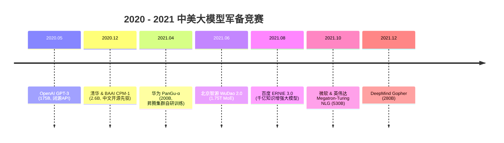

# 第二章：尺度定律与 GPT-3 纪元 (2020 - 2021) —— 涌现、上下文学习与千亿参数竞赛

> **核心主题**：Scaling Laws（尺度定律）、In-Context Learning（上下文学习）、千亿参数工程落地、涌现能力（Emergent Abilities）、中美早期巨模探索。

---

## 1. 理论奠基：OpenAI Scaling Laws (2020.01)

2020 年初，Jared Kaplan 等人（OpenAI）发表里程碑论文 **《Scaling Laws for Neural Language Models》**。这篇论文为大模型时代提供了最重要的第一性原理和工程投资指南。

### 1.1 核心公式与发现

论文发现，自回归语言模型的交叉熵损失（Cross-Entropy Loss $L$）与 **模型参数量（$N$）**、**数据集大小（$D$）** 和 **计算预算（$C$）** 之间遵循精确的**幂律关系（Power Law）**，且几乎不受超参数（如模型深度与宽度、注意力头数）微调的影响：

$$L(N) \approx \left(\frac{N_c}{N}\right)^{\alpha_N}, \quad L(D) \approx \left(\frac{D_c}{D}\right)^{\alpha_D}, \quad L(C) \approx \left(\frac{C_c}{C}\right)^{\alpha_C}$$

```
                Cross-Entropy Loss (L)
                   │
                   │  ●  (Small Model / Small Data)
                   │   \
                   │    \  Power Law: L ∝ C^(-α)
                   │     \  (Predictable Loss Improvement)
                   │      \
                   │       ● (GPT-1)
                   │        \
                   │         ● (GPT-2)
                   │          \
                   │           ● (GPT-3 175B)
                   │            \
                   └────────────────────────── Compute Budget (FLOPs)
```

### 1.2 关键推论与战略影响

1. **规模至上（Scale is All You Need）**：性能平滑可预测，只要投入更多的算力和高质量数据，模型损失就能持续以幂律下降，没有任何平原期（Plateau）迹象。
2. **算力最优分配失误（Kaplan 陷阱）**：Kaplan 早期认为模型参数量增加（$N$）比数据量（$D$）更有效，主张将 73% 的额外计算用于增加模型参数，仅 27% 用于增加数据。这导致了 GPT-3 等模型在后来被证明是“严重欠训练（Under-trained）”的（直至 2022 年 DeepMind 提出 Chinchilla 定律修正此误差）。

---

## 2. 震撼业界：OpenAI GPT-3 (2020.05)

- **论文**：《Language Models are Few-Shot Learners》(Tom B. Brown 等)
- **参数规模**：**1750 亿参数（175B）**（相比 GPT-2 的 1.5B 跃迁超 100 倍）。
- **训练语料**：Common Crawl（经过启发式与分类器过滤）、WebText2、Books1/2、维基百科，共约 3000 亿 token。
- **架构细节**：96 层 Transformer Decoder，$d_{\text{model}} = 12288$，96 个注意力头，采用了交替的局部稠密与局部稀疏注意力（Sparse Attention）。

### 2.1 范式转换：In-Context Learning (上下文学习)

在 GPT-3 之前，主流方法是预训练 + 微调（Fine-Tuning），微调需要针对每个任务更新模型权重，带来巨大存储与部署负担。

GPT-3 提出了 **In-Context Learning (ICL)**：在推理时，仅仅在提示词中提供任务描述和几个样例（Few-Shot Demonstrations），模型无需反向传播更新任何权重即可完成新任务：

```
Prompt:
将英语翻译为法语：
sea otter => loutre de mer
peppermint => menthe poivrée
plush girafe => girafe en peluche
cheese => [模型直接生成: fromage]
```

这证明了超大模型在海量预训练中不仅记住了知识，而且内生了对“任务模式识别”和“元学习（Meta-Learning）”的能力。

### 2.2 涌现能力 (Emergent Abilities) 的争鸣

当模型突破 100B 尺度时，社区观察到一系列在小模型上表现近乎随机、但在大模型上突然呈现非线性跳跃的能力（如多步逻辑推理、算术运算、象征性推理、代码理解）。
- **支持论**：Wei et al. (2022) 认为这是复杂系统因参数量跨过相变临界点而表现出的“涌现”；
- **质疑论**：Schaeffer et al. (2023) 指出，所谓的涌现很大程度上是评估指标非线性（如精确匹配率 0/1）导致的数学幻觉，当采用平滑度量时，能力演进依然是连续的。但无论成因如何，千亿规模展现的综合任务鲁棒性确凿无疑。

### 2.3 商业与开放模式的重大转折

GPT-3 标志着 OpenAI **从非营利研究机构转向商业化封闭 API 体系的转折点**。
- OpenAI 不再公开发布模型权重与训练代码，转而独家授权微软并提供收费 API 访问。
- 这一举措直接促成了后来开源大模型阵营（如 EleutherAI、Meta LLaMA 等）的诞生，大模型领域“闭源商业护城河”与“开源平权”的斗争序幕正式拉开。

---

## 3. 中美科技巨头的千亿军备竞赛 (2020 - 2021)

在 GPT-3 演示了惊人实力后，中美两国的顶级科技巨头与学术机构迅速跟进，掀起全球第一波千亿模型竞赛。



### 3.1 美国巨头的跟进

1. **Nvidia & Microsoft: Megatron-Turing NLG (2021.10)**：
   - 参数规模达到 **5300 亿（530B）**，采用 Megatron-LM 管道并行与 DeepSpeed 3D 并行技术，展示了工业界在万卡 GPU 集群分布式训练工程上的极致调度能力。
2. **DeepMind: Gopher (2021.12)**：
   - 2800 亿参数，系统性评估了语言模型在 Massive Multitask Language Understanding (MMLU) 等 152 项任务上的能力边界。

### 3.2 中国代表性机构的早期探索

中国在此阶段的大模型探索主要由高校、国家实验室与先锋科技企业引领，主要聚焦于**中文原生语料构建**与**国产软硬件协同突破**：

1. **北京智源研究院（BAAI）与清华大学**：
   - **CPM (Chinese Pre-trained Model, 2020.12)**：由清华孙茂松、刘知远团队发起，中国首个开源的大规模中文语言模型（2.6B），打破了当时大模型领域全英文训练语料的垄断。
   - **悟道 2.0 (WuDao 2.0, 2021.06)**：规模高达 1.75 万亿参数（采用 MoE 混合专家架构），在 FastMoE 框架下实现了千亿/万亿规模的稀疏激活训练探索。
2. **华为与鹏城实验室：盘古大模型（PanGu-$\alpha$, 2021.04）**：
   - 参数量达到 **2000 亿（200B）**，基于 2048 块国产华为昇腾 910 芯片（Ascend 910）及 MindSpore 框架完成端到端全自研训练，验证了全栈国产算力支撑超大规模分布式训练的可行性。
3. **百度：文心大模型（ERNIE 3.0, 2021.08）**：
   - 结合知识图谱与海量无标注文本的“知识增强（Knowledge Integration）”预训练架构，参数规模达到千亿，深度整合至百度飞桨（PaddlePaddle）生态。

---

## 4. 定律修正：DeepMind Chinchilla 定律 (2022.03)

虽然发表于 2022 年初，但 **Chinchilla** 论文（《Training Compute-Optimal Large Language Models》）从根本上修正了 2020 年 Kaplan 定律的工程指导方针，直接深刻影响了后续 LLaMA、Mistral 等全系现代模型的训练哲学。

### 4.1 核心发现：模型参数被高估，训练数据被严重低估

Jordan Hoffmann 等人发现，Kaplan 论文在调整学习率衰减策略（Cosine Schedule）时存在系统性偏差。在固定计算预算（Compute Budget $C$）下：
- **最优模型大小与训练 token 数应该等比例同速增长（1:1 Ratio）**：

$$N_{\text{opt}} \propto C^{0.5}, \quad D_{\text{opt}} \propto C^{0.5}$$

### 4.2 案例对比与颠覆性启示

| 维度 | Gopher (DeepMind 2021) | GPT-3 (OpenAI 2020) | Chinchilla (DeepMind 2022) |
| :--- | :--- | :--- | :--- |
| **参数量 ($N$)** | 280B | 175B | **70B (仅 1/4)** |
| **训练 Token 数 ($D$)** | 300B | 300B | **1.4T (4.6 倍)** |
| **总计算开销 ($C$)** | 约 $4.9 \times 10^{23}$ FLOPs | 约 $3.1 \times 10^{23}$ FLOPs | **相同计算量** |
| **下游基准性能** | Baseline | 良好 | **全面碾压 Gopher & GPT-3** |
| **推理延迟与内存显存** | 极高（需 4-8 张 A100） | 高 | **仅需 1-2 张 A100 即可部署** |

> **战略意义**：从此，学术界与开源界彻底转向 **“小尺寸、深训练（Over-training small models on massive data）”** 的路线，为 2023 年 Meta LLaMA（7B/13B 训练在 1T+ token 上）的降维打击埋下了最为关键的理论种子。

---

> 📚 本章引用与一手来源见 [references.md](references.md)；数据字段规范见 [schema.md](../data/schema.md)。
