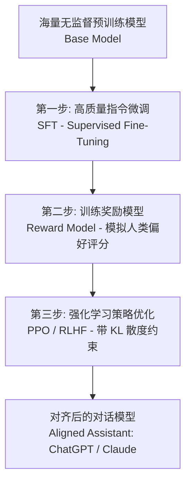

# 第三章：对齐革命与 ChatGPT 引爆点 (2022) —— 指令微调、RLHF 与交互体验跃迁

> **核心主题**：人类对齐（Alignment）、指令微调（Instruction Tuning）、RLHF 强化学习、ChatGPT 的惊世降临、Anthropic 与宪政 AI。

---

## 1. 核心困境：概率续写与人类意图的脱节

截至 2021 年底，以 GPT-3 为代表的预训练模型在能力上极其强大，但对普通用户而言却极难使用。这种矛盾根源于**预训练目标与用户实际意图之间的根本性错位（Misalignment）**：

1. **预训练目标只是“模仿概率续写”**：模型学到的是在互联网语料中最大化下一个词的概率。如果用户提问：“*如何给小猫洗澡？*”，原始 GPT-3 可能会根据网络文章的常见结构，续写出：“*第二章：猫咪沐浴露的选择*” 或追加更多问答题目，而不是直接给出详实解答。
2. **缺乏价值规范与安全边界**：原始模型缺乏过滤机制，极易输出互联网垃圾文本中的有害偏见、毒性词汇、侵权隐私以及恶意攻防指南。
3. **人类对齐的“3H 原则”**：
   - **Helpful（有帮助性）**：准确、详尽地理解并完成用户的指令；
   - **Honest（诚实性）**：如实反映知识边界，避免凭空胡编（幻觉 Hallucination）；
   - **Harmless（无害性）**：拒绝协助危险、违法或反伦理的行为。

---

## 2. 技术突破路径：从指令微调到 RLHF

为解决上述错位，学术界与工业界在 2021-2022 年间摸索出了两套互补的范式：



### 2.1 指令微调（Instruction Tuning）：FLAN 与 T0

- **Google FLAN (Wei et al., 2021)** & **BigScience T0 (Sanh et al., 2021)**：
  - 将传统的 NLP 数据集（翻译、文本蕴涵、问答等）改写为带自然语言提示的指令形式进行多任务微调。
  - 核心发现：在多达数百个任务的指令数据上微调后，模型对**从未见过的全新任务（Unseen Tasks）**具备了令人惊异的零样本零微调理解能力。

### 2.2 核心重器：InstructGPT 与 RLHF 三阶段流程 (2022.03)

2022 年 3 月，OpenAI Long Ouyang 等人发表论文 **《Training language models to follow instructions with human feedback》**（即 **InstructGPT**）。

InstructGPT 证明：**经过 RLHF 对齐的 1.3B 参数小模型，在人类偏好测试中显著超越了未经对齐的 175B 原版 GPT-3**。这确立了大模型后训练（Post-Training）的核心地位。

#### 三阶段数学流程：

1. **第一阶段：监督微调（Supervised Fine-Tuning, SFT）**：
   - 雇佣经过严格培训的人类标注员，编写约 1.3 万条高质量的 Prompt 与理想示范回复，使用标准的交叉熵微调 Base 模型，得到策略模型 $\pi^{\text{SFT}}$。
2. **第二阶段：人类反馈奖励模型训练（Reward Model, RM）**：
   - 模型针对给定 Prompt 生成多个不同回答（如 4 到 9 个），标注员无需逐字打分，而是进行**相对排序（Ranking）**。
   - 采用 Bradley-Terry 偏好模型训练标量奖励模型 $r_\psi(x, y)$，损失函数为：

$$L_R(\psi) = -\mathbb{E}_{(x, y_w, y_l) \sim D}\left[\log \sigma\left(r_\psi(x, y_w) - r_\psi(x, y_l)\right)\right]$$

   其中 $y_w$ 为人类偏好更胜一筹的回答（Winner），$y_l$ 为落选回答（Loser）。
3. **第三阶段：基于 PPO 算法的强化学习（PPO Optimization）**：
   - 使用近端策略优化（PPO）算法，最大化奖励模型给出的分数，同时加入针对原始 SFT 模型的 **KL 散度惩罚项**，防止模型在更新中偏离太远导致“奖励作弊（Reward Hacking）”或遗忘语言连贯性：

$$\max_{\phi} \mathbb{E}_{(x, y)\sim D_{\pi_\phi}}\left[r_\psi(x, y) - \beta D_{\text{KL}}(\pi_\phi(y \mid x) \parallel \pi^{\text{SFT}}(y \mid x))\right] + \gamma \mathbb{E}_{x \sim D_{\text{pretrain}}}[\log \pi_\phi(x)]$$

---

## 3. 引爆世界：ChatGPT 的发布与全球 AI 觉醒 (2022.11.30)

2022 年 11 月 30 日，OpenAI 在其博客上轻描淡写地发布了一个基于 **GPT-3.5 骨干架构（code-davinci-002 / text-davinci-002 演进分支）**并通过对话格式微调的演示产品：**ChatGPT**。

```
                               全球用户突破 1 亿所用时间对比
   Netflix ──────────────────────────────────────────────── 3.5 年
   Twitter ──────────────────────────────────────── 2 年
  Facebook ────────────────────────────── 10 个月
 Instagram ─────────────────────── 2.5 个月
    TikTok ─────────────── 9 个月
   ChatGPT ── 仅 2 个月 (史上最快消费级互联网应用记录)
```

### 3.1 为什么是 ChatGPT 破圈？

1. **会话连续性与指代理解**：不仅能回答单轮问题，还能维持多轮对话上下文，纠正前文中的错误，甚至承认自己的知识盲区。
2. **代码作为强结构推理的媒介**：GPT-3.5 引入了大量 GitHub 源代码预训练（Codex 分支）。研究后来证实，**代码训练极大地激活了模型的长链条严密逻辑推理能力**。
3. **极简交互门槛**：摒弃了晦涩的 API 接口与复杂的参数调节（Temperature、Top-p），普通大众只需一个聊天输入框即可释放生产力。

---

## 4. 安全势力的分流：Anthropic 与宪政 AI (Constitutional AI)

在 OpenAI 加速商业化进程的背景下，原 OpenAI 研究副总裁 Dario Amodei、Daniela Amodei 等多位核心科学家于 2021 年出走创立了 **Anthropic**，致力于构建更可控、更透明、更安全的 Frontier AI。

### 4.1 核心理念：宪政 AI (Constitutional AI / RLAIF)

- **论文**：《Constitutional AI: Harmlessness from AI Feedback》(2022.12)
- **动机**：人类标注员在 RLHF 中存在主观偏见、情绪疲劳、昂贵成本，且人类无法穷尽并审核超大模型的所有有害潜在输出。
- **机制**：
  1. 给模型注入一套明确的“原则宪法”（源自联合国人权宣言、苹果服务条款等）。
  2. 在第一阶段让模型自我批评并修改有害回答（Self-Critique & Revision）；
  3. 在第二阶段使用另一个对齐过的模型（AI Feedback）替代人类进行偏好评分（即 **RLAIF: Reinforcement Learning from AI Feedback**）。
- **产物**：为后续 Anthropic 旗舰模型 **Claude** 的极高无害性、长文本理解与商业信誉奠定了不可动摇的技术根基。

---

## 5. 本阶段关键模型里程碑总结 (2022)

| 模型/技术 | 机构 | 时间 | 开源状态 | 关键创新与架构地位 |
| :--- | :--- | :--- | :--- | :--- |
| **FLAN / T0** | Google / BigScience | 2021-2022 | 开源 | 确立大规模指令微调（Instruction Tuning）范式 |
| **Chinchilla** | DeepMind | 2022.03 | 闭源 | 修正 Scaling Laws，奠定现代“小参数、超大训练语料”共识 |
| **InstructGPT** | OpenAI | 2022.03 | 闭源 API | 完整实现 SFT + RM + PPO 的 RLHF 对齐三部曲 |
| **BLOOM** | BigScience | 2022.07 | 全开源 | 全球多国学者联合打造的 176B 多语言开放模型 |
| **Minerva** | Google | 2022.06 | 闭源 | 专攻数学推理，验证思维链（Chain of Thought）力量 |
| **ChatGPT** | OpenAI | 2022.11 | 闭源应用 | 对话式大模型消费级引爆点，拉开全球生成式 AI 狂潮 |
| **Constitutional AI** | Anthropic | 2022.12 | 论文/闭源 | 提出 RLAIF 与宪政 AI，为 Claude 模型家族奠基 |

---

> 📚 本章引用与一手来源见 [references.md](references.md)；数据字段规范见 [schema.md](../data/schema.md)。
