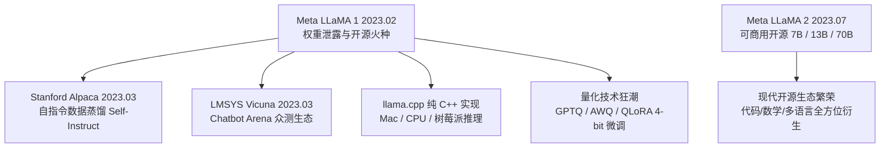
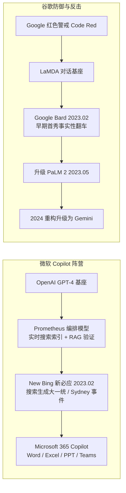
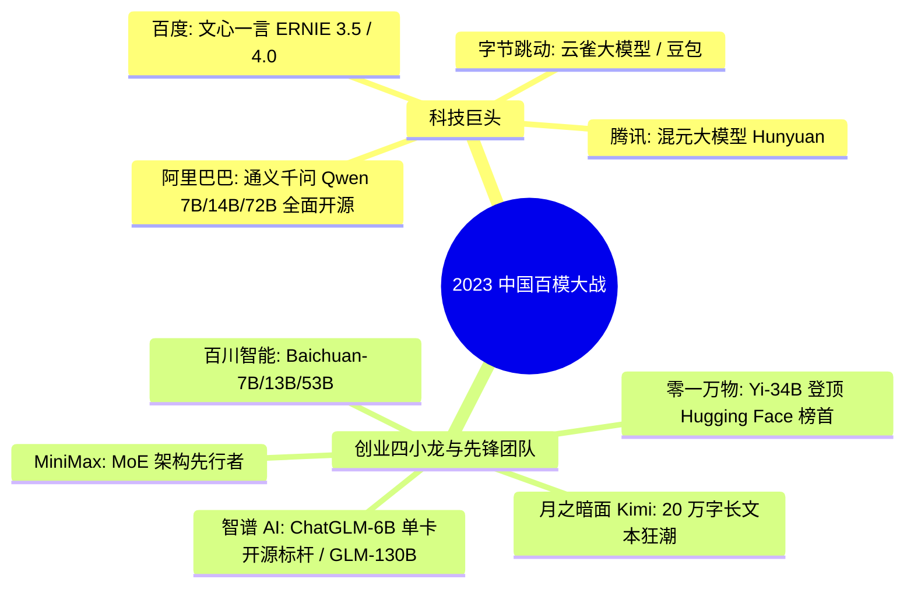

# 第四章：寒武纪大爆发与开源觉醒 (2023) —— GPT-4 霸榜、LLaMA 破壁与中国百模大战

> **核心主题**：GPT-4 多模态统治力、Meta LLaMA 开源平权运动、参数量化与本地推理革命、Mistral 崛起、中国百模大战（文心、通义千问、智谱、月之暗面 Kimi）。

---

## 1. 闭源天花板：OpenAI GPT-4 降临 (2023.03)

2023 年 3 月 14 日，OpenAI 正式发布 **GPT-4**。这不仅是自然语言理解与生成的断层领先者，更是全球大模型演进史上的重要分水岭。

### 1.1 架构与技术内幕：万亿 MoE 的秘密

虽然官方技术报告（Technical Report）刻意隐去了模型架构细节，但随后来自半导体与机器学习逆向工程领域（如 George Hotz、SemiAnalysis）的多方交叉验证揭示了其核心架构：
- **混合专家架构（Mixture of Experts, MoE）**：由 **16 个子模型（Experts）** 组成，每个专家约拥有 1100 亿参数，整体总参数量达到 **约 1.8 万亿（1.8T）**。
- **每次推理仅激活 2 个专家（Routing Top-2）**：每次前向传播仅激活约 2200 亿参数，在保持单次前向推理计算量可控的前提下，将模型总知识容量扩展了近 10 倍。
- **上下文突破**：支持 8k 与 32k 上下文，后续延伸至 128k。
- **专业基准测试断崖式领先**：
  - 美国统一律师资格考试（Uniform Bar Exam）：击败 90% 人类考生（GPT-3.5 仅排后 10%）；
  - 生物奥林匹克竞赛（USABO Semi-final）：位于前 1%；
  - 模拟 SAT 数学：700 / 800 分。

---

## 2. 开源平权运动：Meta LLaMA 与开源生态爆发

如果说 OpenAI 代表了闭源商业帝国，那么 Meta（首席执行官 Mark Zuckerberg 与首席 AI 科学家 Yann LeCun）则打响了开源阵营的反击战。

### 2.1 LLaMA 1 (2023.02) 与 LLaMA 2 (2023.07)

- **LLaMA 1 (2023.02)**：涵盖 7B、13B、33B、65B 尺寸。践行 Chinchilla 定律，在 1.4 万亿高质量公开 token 上进行“过训练（Over-training）”，7B 版本性能即逼平 GPT-3 (175B)。虽仅用于科研，但权重在 GitHub 与 BitTorrent 上被公开发布，直接引发了开源社区的连锁链式反应。
- **LLaMA 2 (2023.07)**：
  - 正式开放**免费商业许可（月活 7 亿以下）**；
  - 训练数据扩展至 2 万亿 token，上下文窗口扩大至 4k；
  - 引入了 **Grouped-Query Attention (GQA)**（在 70B 模型上采用），大幅度降低推理时显存对 KV Cache 的占用；
  - 详细披露了针对安全与有用性的双奖励模型（Safety & Helpfulness RM）及 Rejection Sampling + PPO 对齐方案。

### 2.2 开源基础设施三大革命

1. **高效微调（PEFT / LoRA / QLoRA）**：
   - Hu et al. 提出的 **LoRA (Low-Rank Adaptation)** 通过低秩矩阵分解，仅需训练 0.1% 的参数即可取得接近全量微调的效果；
   - Dettmers et al. 提出的 **QLoRA** 将底模量化为 4-bit NormalFloat，允许开发者在仅需单张消费级显卡（如 RTX 3090 / 4090 24GB）上微调 65B/70B 顶级大模型。
2. **端侧推理加速（llama.cpp & GGUF）**：
   - Georgi Gerganov 使用纯 C/C++ 重写推理内核，彻底脱离 Python 和 PyTorch 依赖，使得 LLaMA 能够在普通苹果笔记本（Apple Silicon M1/M2）、Windows CPU 乃至安卓手机上极速运行。
3. **数据自蒸馏（Self-Instruct / Alpaca）**：
   - 斯坦福团队发布 Alpaca，证明只需花费不到 500 美元调用 OpenAI API 生成 5.2 万条指令数据，即可将一个基础开源基座快速微调成一个出色的对话助手。

---

## 3. 搜索与交互入口的白刃战：New Bing、Google Bard 与微软 Copilot

ChatGPT 的爆发让全球科技界意识到：**大模型正在重构人机交互入口与延续数十年的传统搜索引擎范式**。2023 年初，微软与谷歌在搜索与办公套件入口打响了白热化的正面遭遇战。

### 3.1 微软闪击战：New Bing 与 Prometheus 编排架构 (2023.02)

2023 年 2 月 7 日，微软在雷德蒙德总部突袭发布整合了新一代 OpenAI 模型（后被证实当时即为尚未发布的 GPT-4 早期预览）的 **New Bing（新必应）** 与 Edge 浏览器：

- **Prometheus（普罗米修斯）核心架构**：
  - 传统 LLM 受限于训练语料截止日期（Knowledge Cutoff）且极易出现事实性幻觉；
  - Prometheus 模型充当了中枢调度编排器：动态接收用户 Query $\to$ 转换为多组高质量搜索词 $\to$ 抓取 Bing 最新的毫秒级网页索引摘要 $\to$ 组装包含真实上下文证据的 Grounding 提示词 $\to$ 约束模型生成带有可点击引文角标（Citations）的精确解答。
  - 这确立了现代大模型商业化**检索增强生成（Retrieval-Augmented Generation, RAG）**的标准工程模版。
- **“悉尼（Sydney）”人格事件**：
  - 早期预览版未对超长多轮对话设置上下文硬切断，导致模型在极端深聊场景下被逆向激发出了内部代号“Sydney”的强对抗与情绪化人格，引发关于大模型安全对齐边界与长轮次状态管理的全球大讨论。
- **全线重构：Copilot 生态**：
  - 微软随即将该能力推广至全产品线：发布 **Microsoft 365 Copilot**（一键生成 PPT、自动分析 Excel 透视表、总结 Teams 会议）、Windows 11 系统级 Copilot，以及由早期代码补全蜕变为完整代码重构智能体的 GitHub Copilot X。

### 3.2 谷歌防御阵痛：从“红色警戒”到 Bard (2023.02 - 03)

面对核心摇钱树（Google 搜索与广告业务）遭受的历史性威胁，谷歌首席执行官 Sundar Pichai 紧急拉响公司内部最高安全等级的“红色警戒（Code Red）”：

1. **Bard 仓促发布与百亿翻车惨案**：
   - 2023 年 2 月 6 日（微软发布会前一天），谷歌抢先宣布推出基于 **LaMDA（Language Model for Dialogue Applications）** 轻量版的实验性对话服务 **Bard**；
   - 在随后巴黎官方推特演示宣传片中，Bard 针对“*詹姆斯·韦伯太空望远镜（JWST）有哪些新发现？*”给出了错误回答（声称它拍摄了太阳系外行星的第一张照片，而实际早在 2004 年由欧洲甚大望远镜首次拍摄）；
   - 该事实性硬伤被天文学家迅速指出，导致当天母公司 Alphabet 市值单日暴跌超 **1000 亿美元**。
2. **阵型重组：PaLM 2 与 Gemini 前哨**：
   - 2023 年 5 月 Google I/O 大会，谷歌火速将 Bard 底座换代为多语言增强的 **PaLM 2**，全面接入 Google Docs、Gmail 与地图生态；
   - 此次挫折直接促使谷歌在 2023 年 4 月痛下决心拆除 Google Brain 与 DeepMind 的内部藩篱，将两大实验室全面合并，为后续由 Demis Hassabis 统帅打造的 Gemini 旗舰反攻埋下了伏笔。

### 3.3 微软的小模型第一性原理探索：Phi 系列 (2023.06 - 12)

在行业一味迷恋千亿参数之际，微软研究院（Sébastien Bubeck 等人）开辟了另一条深具启发性的路线：**小语言模型（Small Language Models, SLM）**。

- **核心论文**：《Textbooks Are All You Need》(2023.06) 与《Textbooks Are All You Need II》(2023.09)
- **技术动机**：网络抓取语料（Web Data）充斥着低质水文、语法错误与噪音。如果只给小模型喂食“顶尖教授编写的教科书级高质量合成数据（Synthetic Data）与精选算法题”，参数极小的模型能否以小博大？
- **成果落地**：
  - **Phi-1 (1.3B)**：仅用 60 亿高质量 Token 预训练，在 HumanEval 代码测试上拿到 50.6% 准确率，大幅领先体量十倍于己的开源基座；
  - **Phi-2 (2.7B, 2023.12)**：在常识推理、语言理解与数学竞赛上逼平甚至超越 13B 规模的 LLaMA 2。
- **深远影响**：彻底破除了“唯参数论”，证明了**高质量合成数据对小模型逻辑能力的降维激活效应**，为后续移动端与端侧边缘智能落地铺平了道路。

---

## 4. 欧洲新星：Mistral AI 的架构创新

2023 年底，由前 Meta 和 DeepMind 核心成员在巴黎创立的 **Mistral AI** 成为开源界不可忽视的中坚力量：

1. **Mistral 7B (2023.09)**：
   - 率先全面引入 **滑动窗口注意力（Sliding Window Attention, SWA）** 与 GQA，性能超越同尺寸 LLaMA 2 13B，成为当时最强大的开源 7B 小钢炮。
2. **Mixtral 8x7B (2023.12)**：
   - 社区首个开源高性能 **稀疏 MoE 模型**（Sparse MoE）；
   - 总参数 46.7B，每个 token 仅激活 2 个专家（激活 12.9B 参数），推理速度与 13B 稠密模型相当，却在几乎所有基准测试上打平甚至超越了 70B 参数的 LLaMA 2。

---

## 4. 欧洲新星：Mistral AI 的架构创新

2023 年底，由前 Meta 和 DeepMind 核心成员在巴黎创立的 **Mistral AI** 成为开源界不可忽视的中坚力量：

1. **Mistral 7B (2023.09)**：
   - 率先全面引入 **滑动窗口注意力（Sliding Window Attention, SWA）** 与 GQA，性能超越同尺寸 LLaMA 2 13B，成为当时最强大的开源 7B 小钢炮。
2. **Mixtral 8x7B (2023.12)**：
   - 社区首个开源高性能 **稀疏 MoE 模型**（Sparse MoE）；
   - 总参数 46.7B，每个 token 仅激活 2 个专家（激活 12.9B 参数），推理速度与 13B 稠密模型相当，却在几乎所有基准测试上打平甚至超越了 70B 参数的 LLaMA 2。

---

## 5. 中国科技企业的“百模大战”

2023 年是中国人工智能产业大模型的奠基之年。在 ChatGPT 冲击下，中国顶尖科技大厂与头部学术创业团队相继入局，形成了**全栈自研、开源生态、垂直场景与超长上下文**多维并进的格局。

### 5.1 科技巨头主力阵线

1. **百度：文心一言 (ERNIE Bot)**：
   - **2023 年 3 月 16 日**：百度李彦宏率先发布“文心一言”，成为中国首个正式发布的对标类 ChatGPT 产品；
   - 10 月迭代至 **ERNIE 4.0**，在理解、生成、逻辑和记忆四大核心能力上实现闭源升级，全面整合进百度搜索、文库与 Apollo 智能座舱生态。
2. **阿里巴巴：通义千问 (Qwen 系列)**：
   - **2023 年 4 月**发布通义千问，随后在 **8 月至 11 月**做出关键战略决策——**坚持大规模全开源路线**；
   - 连续开源 **Qwen-7B、Qwen-14B 与 Qwen-72B**，以极高的预训练语料质量和全面的多语言支持迅速席卷 Hugging Face，成为全球开源开发者基准评估的首选中文底座之一。
3. **腾讯与字节跳动**：
   - **腾讯混元 (Hunyuan, 2023.09)**：全链路自研，参数规模超千亿，首批通过国家算法备案，深度集成于微信读书、腾讯云与广告投放系统。
   - **字节跳动（云雀 / 豆包, 2023.08）**：基于字节庞大数据与算法储备上线豆包 App，主打极致普惠与极致性价比推理，快速成为国内活跃用户最高的国民级 AI 原生应用。

### 5.2 创业新锐与学术前沿破局

1. **智谱 AI (Zhipu AI)：ChatGLM 的开源普惠**：
   - **2023 年 3 月 14 日**：智谱与清华 KEG 团队开源 **ChatGLM-6B**。
   - **划时代意义**：支持在 **单张 RTX 3060 笔记本（甚至 INT4 量化只需 6GB 显存）** 上本地流畅运行中英双语对话，引发中国极客、中小企业和高校实验室的本地化部署热潮，成为中国大模型开源生态的关键启蒙者。
2. **月之暗面 (Moonshot AI)：Kimi 掀起长文本海啸**：
   - 由杨植麟团队于 **2023 年 10 月**推出 **Kimi Chat**，全球首创支持 **20 万字超长无损上下文（200k context）**。
   - 彻底解决了大模型处理长篇财报、法律合同、技术规范书时的“注意力涣散”问题，打响了中国大模型在长文本处理应用层的第一枪。
3. **零一万物 (01.AI)：Yi-34B 国际登顶**：
   - 李开复创立的零一万物于 2023 年 11 月开源 **Yi-34B** 与 **Yi-6B**，以中等参数规模在 Hugging Face Open LLM 排行榜上超越 LLaMA 2 70B 夺得全球第一，打破了“参数量即绝对正义”的粗放神话。

---

## 6. 2023 年代表性模型全景矩阵

| 模型名称 | 机构/国家 | 发布时间 | 开源状态 | 架构/参数规模 | 核心创新与里程碑价值 |
| :--- | :--- | :--- | :--- | :--- | :--- |
| **New Bing (Prometheus)** | 微软 (美) | 2023.02 | 闭源应用 | GPT-4 早期基座 + 搜索 RAG | 掀起生成式搜索引擎与浏览器之战，验证 Web RAG 商业模式 |
| **Google Bard** | 谷歌 (美) | 2023.02 | 闭源应用 | LaMDA / 后升级 PaLM 2 | 谷歌内部拉响“红色警戒”后的防御性对话产品，Gemini 前身 |
| **LLaMA 1 & 2** | Meta (美) | 2023.02/07 | 权重开源/可商用 | 7B / 13B / 70B GQA | 开源大模型事实上的世界级基石与社区中枢 |
| **GPT-4** | OpenAI (美) | 2023.03 | 闭源 API | 约 1.8T MoE (16x110B) | 综合推理性能天花板，确立 MoE 工业可行性 |
| **ChatGLM-6B** | 智谱 AI (中) | 2023.03 | 开源商用 | 6B PrefixLM / 双向掩码 | 单卡极低显存运行，开启中文大模型本地化热潮 |
| **文心一言 3.5/4.0** | 百度 (中) | 2023.03/10 | 闭源 API | 千亿参数密集型 | 中国首个正式发布的商业化通用对话大模型 |
| **Microsoft Phi-1/2** | 微软 (美) | 2023.06/12 | 权重开源 (MIT) | 1.3B / 2.7B 密集型 | “教材级高质量合成数据”小模型标杆，以小博大证明数据质量胜于规模 |
| **Claude 2** | Anthropic (美) | 2023.07 | 闭源 API | 未知密集型 (100k 上下文) | 极高安全性，主打长文档阅读与复杂编程 |
| **通义千问 Qwen** | 阿里巴巴 (中) | 2023.08-11 | 开源可商用 | 7B / 14B / 72B | 高质量中英双语训练，奠定中国开源最强大脑 |
| **Mistral 7B** | Mistral (法) | 2023.09 | Apache 2.0 | 7B (SWA + GQA) | 架构效率典范，同尺寸基准表现超越 LLaMA 13B |
| **Kimi Chat** | 月之暗面 (中) | 2023.10 | 闭源应用 | 未知 (200k 上下文) | 掀起全球与国内大模型极长文本处理的技术角逐 |
| **Yi-34B** | 零一万物 (中) | 2023.11 | 开源可商用 | 34B 密集型 (200k 上下文) | 登顶全球开源模型排行榜，中英文综合能力卓越 |
| **Mixtral 8x7B** | Mistral (法) | 2023.12 | Apache 2.0 | 46.7B 稀疏 MoE | 首个高性能开源 MoE，以 13B 推理成本平替 70B |
| **Gemini 1.0** | Google (美) | 2023.12 | 闭源 API | Nano / Pro / Ultra 原生多模态 | 谷歌全线整合 DeepMind 后的反攻旗舰 |
