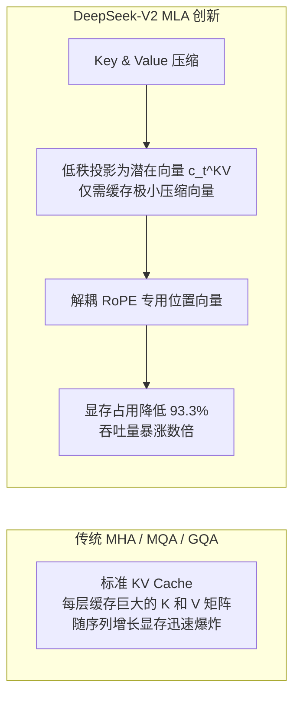

# 第五章：MoE 普及、极致上下文与架构效率重构 (2023 末 - 2024 中)

> **核心主题**：百万人格上下文窗口（1M - 2M Context）、原生多模态（Native Multimodality）、LLaMA 3.1 405B 开源里程碑、DeepSeek-V2 架构创新（MLA 与 DeepSeekMoE）、全球推理降价浪潮。

---

## 1. 百万 Token 上下文革命：大海捞针与无限信息流

在 2023 年，大模型的上下文窗口普遍停留在 4k、8k 或 32k。当面对超长书籍、整套项目代码库或数小时的音视频时，传统模型只能依赖 RAG（检索增强生成）进行切片检索。然而，RAG 容易切断语法依存关系并遗漏全局隐式关联。

### 1.1 Google Gemini 1.5 Pro (2024.02)：100 万至 200 万 Token 的长距离召回

Google DeepMind 发布了基于 MoE 架构的 **Gemini 1.5 Pro**，将上下文窗口直接推升至 **100 万（1M）甚至 200 万（2M）Token**：
- **Needle In A Haystack (NIAH, 大海捞针测试)**：在长达 100 万 token 的庞大语料库中，针对隐藏在任意深度（0% 到 100% 深度区间）的事实片段，实现了 **99.7% 以上的近乎完美精确召回**。
- **跨模态全息理解**：用户可以直接向模型上传长达 1 小时的无剪辑视频、数百页的复杂财报或者包含数十万行代码的完整软件仓库，模型能即时理解其全局架构并进行因果追踪。

### 1.2 中国长文本军备竞赛

继月之暗面 Kimi 于 2023 年底打响 20 万字第一枪后，2024 年 3 月 Kimi 宣布启动 **200 万字** 无损上下文内测；随后百度文心、阿里通义千问（开源 1000 万字上下文支持）、智谱清言等迅速跟进，推动了长上下文成为现代大模型的行业标配。

---

## 2. 端到端原生多模态：从级联拼接走向端到端统一

以往的“多模态”AI 普遍采用级联管道架构（Pipeline Architecture）：
`语音输入` $\xrightarrow{\text{ASR (Whisper)}}$ `文本` $\xrightarrow{\text{LLM 思考}}$ `文本输出` $\xrightarrow{\text{TTS 语音合成}}$ `音频播放`。
这种级联设计造成了三个致命缺陷：
1. **高延迟（Latency）**：每个模块串行计算，端到端延迟通常在 1.5 秒到 3 秒以上，无法支持自然的实时交谈打断；
2. **情感与非语言信息的巨大损耗**：说话者的语气、情绪起伏、背景环境杂音、语调反讽在 ASR 阶段被粗暴抹平为纯文本；
3. **图像理解与文本空间的分立**。

### 2.1 OpenAI GPT-4o (2024.05)：全能实时端到端交互

2024 年 5 月，OpenAI 发布 **GPT-4o（“o” 代表 Omni，全能）**：
- **统一多模态端到端 Transformer**：单个神经网络直接接受文本、视觉与音频的原始信号输入，直接联合自回归输出文本、视觉或原生音频波形。
- **232 毫秒极致延迟**：平均响应延迟仅 320 毫秒（人类面对面对话的平均反应时间约为 250 毫秒），支持被用户自然插话打断（Barge-in）。
- **情绪共鸣与多重声调**：能听懂喘息声、笑声、耳语，并能自由调整语调（从戏剧化的朗诵到沉稳的学术汇报）。

### 2.2 Anthropic Claude 3.5 Sonnet (2024.06)：工程、代码与视觉理解的新国王

Anthropic 于 2024 年 6 月发布 **Claude 3.5 Sonnet**：
- 在代码（HumanEval）、复杂数学与专业博士生水准推理（GPQA Diamond）上刷新所有闭源与开源 SOTA，并首次超越了 GPT-4o。
- 推出 **Artifacts** 交互范式：在聊天对话框右侧建立专属交互画布，模型生成的代码、网页、Mermaid 图表与 SVG 能够实时在浏览器端动态渲染并即时交互，重构了大模型时代的人机协同体验。

---

## 3. 开源世界的 400B 巨擘：Meta LLaMA 3 & 3.1 (2024.04 - 07)

Meta 坚持开源路线，于 2024 年 4 月与 7 月相继发布 LLaMA 3 与 LLaMA 3.1：

1. **庞大的训练算力集群**：LLaMA 3.1 405B 在超过 **1.6 万张英伟达 H100 80GB GPU** 集群上进行了数个月的连续分布式训练。
2. **训练语料规模的指数跃升**：训练语料由 LLaMA 2 的 2T Token 激增至 **超过 15 万亿（15T）Token**，词表扩展至 128k（Tiktoken 格式），全面增强了代码与非英语多语言能力。
3. **首个开源 400B+ 旗舰模型**：LLaMA 3.1 405B 成为开源史上首个在通用推理与知识掌握上全面匹敌 GPT-4o 和 Claude 3.5 Sonnet 等头部商业闭源巨模的开源重器。

---

## 4. 架构效率的中国破局：DeepSeek-V2 的 MLA 与 DeepSeekMoE (2024.05)

2024 年 5 月，中国量化对冲背景的 AI 新锐机构 **幻方量化旗下 DeepSeek（深度求索）** 发布 **DeepSeek-V2**，以惊世骇俗的架构创新，彻底改写了全球大模型推理显存与训练成本的经济学公式。



### 4.1 多头潜在注意力 (Multi-Head Latent Attention, MLA)

#### 核心痛点：推理瓶颈在于显存带宽（Memory Bandwidth Bound）
在模型推理生成阶段（Generation Phase），每次预测下一个 token 都需要从 GPU 显存中读取之前所有 token 的 Key 和 Value 缓存（KV Cache）。当批量并发增大、上下文达到数万甚至数百万时，KV Cache 的体积会远超模型权重本身，导致计算核心（Tensor Core）长期处于等待显存数据传输的闲置饥饿状态。

#### MLA 的数学优雅解：
DeepSeek-V2 没有采用业界常规的 GQA（Grouped-Query Attention），而是提出 **低秩联合压缩（Low-Rank Compression）**：

将所有的 Key 和 Value 向量联合投影压缩为一个极小的隐空间潜在向量 $c_t^{KV}$：

$$c_t^{KV} = W^{DKV} h_t, \quad c_t^{KV} \in \mathbb{R}^{d_c}$$

其中压缩维度 $d_c \ll d_h \times n_h$。在推理时，GPU 显存中 **仅仅需要缓存这个极小的 $c_t^{KV}$ 向量**，而在计算注意力时再通过投影矩阵与 Query 进行点积吸收合并：

$$\text{KV Cache 压缩率达到惊人的 } \mathbf{93.3\%}$$

这意味着在相同硬件配置下，单台服务器所能承载的最大并发会话请求（Batch Size）提升了接近一个数量级！

### 4.2 细粒度专家混合架构：DeepSeekMoE

传统 MoE（如 Mixtral 8x7B）通常由 8 个粗粒度专家组成，每次激活 2 个。这种设计存在两个弊端：专家特异性不足、不同专家之间的知识严重冗余重复。

DeepSeekMoE 提出了两项关键变革：
1. **专家细粒度拆分（Fine-Grained Segmentation）**：将传统一个专家切分为细小碎片。以 DeepSeek-V2 为例，总共有 160 个路由专家（Routed Experts），每次激活 6 个细粒度专家。
2. **共享专家隔离机制（Shared Experts Isolation）**：特别指定 2 个专家作为**始终常驻激活的共享专家（Shared Experts）**，专门用来吸收所有领域公用的通用常识知识，从而让剩下的 160 个动态专家能够心无旁骛地高度专业化垂直领域的独特技能。

```
DeepSeek-V2 规格：
- 总参数量：2360 亿 (236B)
- 单 Token 激活参数量：仅 210 亿 (21B)
- 推理吞吐：达到甚至超越同体量稠密模型的 3 - 5 倍
```

### 4.3 全球大模型“断崖式降价浪潮”

DeepSeek 将其超高吞吐效率直接反馈至商业定价：
- DeepSeek-V2 API 每百万 Token 输入仅需 **1 元人民币（约合 0.14 美元）**，输出仅需 **2 元人民币**。
- 这一价格仅为同时期 OpenAI GPT-4 定价的 **百分之一（1/100）**。
- 这引发了全球范围内的 API 大降价（智谱、百度、阿里通义、字节豆包相继宣布大模型主力版本大幅度降价甚至针对小模型直接免费），彻底打破了大模型昂贵推理成本的门槛。

---

## 5. 中国开源生态的全面进击：阿里巴巴 Qwen 2 & Qwen 2.5 (2024.06 - 09)

阿里巴巴通义千问团队在此阶段构建了全球最完备、最多样化的开源模型矩阵：
- **Qwen 2 (2024.06)**：推出 0.5B、1.5B、7B、57B-A14B (MoE)、72B 等多种尺寸，全面超越同尺寸 LLaMA 3。
- **Qwen 2.5 (2024.09)**：
  - 语料扩充至 **18 万亿（18T）Token**，支持长达 128k 上下文；
  - 针对编程与数学分别开源了 **Qwen2.5-Coder** 与 **Qwen2.5-Math**；
  - 32B 版本凭借极佳的尺寸与性能平衡，成为全球开发者自建企业级 Private Coding Agent 与垂直知识库的首选基座。

---

## 6. 本阶段核心里程碑对比表 (2023 末 - 2024 中)

| 模型名称 | 机构/国家 | 发布时间 | 开源状态 | 架构特性与核心参数 | 行业震动与里程碑价值 |
| :--- | :--- | :--- | :--- | :--- | :--- |
| **Gemini 1.5 Pro** | Google (美) | 2024.02 | 闭源 API | 稀疏 MoE / 1M-2M Context | 重新定义长上下文能力，大海捞针测试基准树立者 |
| **Claude 3 系列** | Anthropic (美) | 2024.03 | 闭源 API | Haiku / Sonnet / Opus | Opus 版本首次在通用评测上全面挑落 GPT-4 |
| **Kimi 200万字** | 月之暗面 (中) | 2024.03 | 闭源应用 | 超长文本架构优化 | 掀起中国长上下文技术战与白领生产力革命 |
| **LLaMA 3 (8B/70B)** | Meta (美) | 2024.04 | 权重开源 | 8B / 70B 密集型 (15T Token) | 全面重写开源标准，中等尺寸性能跃升 |
| **DeepSeek-V2** | DeepSeek (中) | 2024.05 | 开源商用 | 236B MoE (激活 21B), MLA 架构 | MLA 架构降显存 93%，断崖式降价引爆全球价格战 |
| **GPT-4o** | OpenAI (美) | 2024.05 | 闭源 API | 原生跨模态端到端 Omni 架构 | 232ms 极低延迟，重构人机实时语音与视觉交互 |
| **Claude 3.5 Sonnet**| Anthropic (美) | 2024.06 | 闭源 API | 顶级推理与编程密集体 | 登顶全球 Coding/Agent 第一宝座，推出 Artifacts 画布 |
| **LLaMA 3.1 405B** | Meta (美) | 2024.07 | 权重开源 | 405B 密集型 (1.6万卡训练) | 开源史上首个匹敌闭源 Frontier 的 400B+ 旗舰基石 |
| **Qwen 2.5 系列** | 阿里巴巴 (中) | 2024.09 | 开源可商用 | 0.5B - 72B, Coder/Math 专精 | 覆盖全尺寸全场景的全球最强开源模型家族之一 |

---

> 📚 本章引用与一手来源见 [references.md](references.md)；数据字段规范见 [schema.md](../data/schema.md)。
