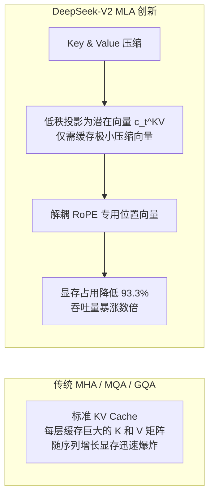

# 第五章：MoE 普及、极致上下文与架构效率重构 (2023 末 - 2024 中)

> **核心主题**：百万人格上下文窗口（1M - 2M Context）、原生多模态（Native Multimodality）、LLaMA 3.1 405B 开源里程碑、DeepSeek-V2 架构创新（MLA 与 DeepSeekMoE）、推理基础设施突破（FlashAttention / PagedAttention / SGLang / Speculative Decoding）、线性注意力与长上下文折返探索。

---

## 1. 百万 Token 上下文革命：大海捞针与无限信息流

在 2023 年，大模型的上下文窗口普遍停留在 4k、8k 或 32k。当面对超长书籍、整套项目代码库或数小时的音视频时，传统模型只能依赖 RAG（检索增强生成）进行切片检索。然而，RAG 容易切断语法依存关系并遗漏全局隐式关联。

### 1.1 Google Gemini 1.5 Pro (2024.02)：100 万至 200 万 Token 的长距离召回

Google DeepMind 发布了基于 MoE 架构的 **Gemini 1.5 Pro**，将上下文窗口直接推升至 **100 万（1M）甚至 200 万（2M）Token**：
- **Needle In A Haystack (NIAH, 大海捞针测试)**：在长达 100 万 token 的庞大语料库中，针对隐藏在任意深度（0% 到 100% 深度区间）的事实片段，实现了 **99.7% 以上的近乎完美精确召回**。
- **跨模态全息理解**：用户可以直接向模型上传长达 1 小时的无剪辑视频、数百页的复杂财报或者包含数十万行代码的完整软件仓库，模型能即时理解其全局架构并进行因果追踪。

### 1.2 中国长文本军备竞赛
继月之暗面 Kimi 于 2023 年底打响 20 万字第一枪后，2024 年 3 月 Kimi 宣布启动 **200 万字** 无损上下文内测；随后百度文心、阿里通义千问（开源 1000 万字上下文支持）、智谱清言等迅速跟进，推动了长上下文成为现代大模型的行业标配。

---

## 2. 端到端原生多模态：从级联拼接走向端到端统一

以往的“多模态”AI 普遍采用级联管道架构（Pipeline Architecture）：
`语音输入` $\xrightarrow{\text{ASR (Whisper)}}$ `文本` $\xrightarrow{\text{LLM 思考}}$ `文本输出` $\xrightarrow{\text{TTS 语音合成}}$ `音频播放`。
这种级联设计造成了三个致命缺陷：
1. **高延迟（Latency）**：每个模块串行计算，端到端延迟通常在 1.5 秒到 3 秒以上，无法支持自然的实时交谈打断；
2. **情感与非语言信息的巨大损耗**：说话者的语气、情绪起伏、背景环境杂音、语调反讽在 ASR 阶段被粗暴抹平为纯文本；
3. **图像理解与文本空间的分立**。

### 2.1 OpenAI GPT-4o (2024.05)：全能实时端到端交互
2024 年 5 月，OpenAI 发布 **GPT-4o（“o” 代表 Omni，全能）**：
- **统一多模态端到端 Transformer**：单个神经网络直接接受文本、视觉与音频的原始信号输入，直接联合自回归输出文本、视觉或原生音频波形。
- **232 毫秒极致延迟**：平均响应延迟仅 320 毫秒（人类面对面对话的平均反应时间约为 250 毫秒），支持被用户自然插话打断（Barge-in）。
- **情绪共鸣与多重声调**：能听懂喘息声、笑声、耳语，并能自由调整语调。

### 2.2 Anthropic Claude 3.5 Sonnet (2024.06)：工程与编程的新王座
- 在代码（HumanEval）、复杂数学与专业博士生水准推理（GPQA Diamond）上刷新所有闭源与开源 SOTA，并首次超越了 GPT-4o。
- 推出 **Artifacts** 交互范式：在聊天对话框右侧建立专属交互画布，模型生成的代码、网页、Mermaid 图表与 SVG 能够实时在浏览器端动态渲染并即时交互。

---

## 3. 开源世界的 400B 巨擘：Meta LLaMA 3 & 3.1 (2024.04 - 07)

Meta 坚持开源路线，于 2024 年 4 月与 7 月相继发布 LLaMA 3 与 LLaMA 3.1：
1. **庞大的训练算力集群**：LLaMA 3.1 405B 在超过 **1.6 万张英伟达 H100 80GB GPU** 集群上进行了数个月的连续分布式训练。
2. **训练语料规模的指数跃升**：训练语料由 LLaMA 2 的 2T Token 激增至 **超过 15 万亿（15T）Token**，词表扩展至 128k。
3. **首个开源 400B+ 旗舰模型**：LLaMA 3.1 405B 成为开源史上首个在通用推理与知识掌握上全面匹敌 GPT-4o 和 Claude 3.5 Sonnet 的开源重器。

---

## 4. 架构效率突破：MLA、细粒度 MoE 与稀疏注意力

2024 年 5 月，DeepSeek 发布 **DeepSeek-V2**，以 MLA 与细粒度专家重塑全球大模型经济学：



### 4.1 多头潜在注意力 (Multi-Head Latent Attention, MLA)
- **痛点**：长上下文生成时，读取巨大的 KV Cache 导致计算核心受制于显存带宽（Memory Bandwidth Bound）；
- **MLA 数学解**：将所有的 Key 和 Value 向量联合投影压缩为一个极小的隐空间潜在向量 $c_t^{KV} = W^{DKV} h_t$，在推理时仅需在显存中缓存该微小向量，**KV Cache 显存占用直接降低 93.3%**。

### 4.2 细粒度专家 (DeepSeekMoE) 与 原生稀疏注意力 (DeepSeek NSA)
- **细粒度路由 + 隔离共享专家**：DeepSeek-V2 设 160 个动态专家（每次激活 6 个）并设立 2 个常驻共享专家，兼具常识积累与垂直领域深度；
- **原生稀疏注意力 (Native Sparse Attention, NSA)**：DeepSeek 进一步探索硬件对齐的预训练稀疏注意力，跳过事后剪枝，在预训练阶段直接学习细粒度动态稀疏路径，打破长程自注意力的平方计算复杂度。

### 4.3 线性注意力与长上下文的“架构折返”探索
在长上下文演进过程中，工业界经历了极具启发性的技术探索与折返：
- **MiniMax-01 (2025.01)**：456B MoE（激活 45.9B），率先采用 **Lightning Attention 线性注意力机制** 挑战 400 万 Token（4M Context）长上下文，在超长文本处理上展现出极高的吞吐能效；
- **MiniMax M2 的 Full Attention 回归 (2026.03)**：然而，在面对复杂的代码工程调试、多步智能体长程因果规划与严密逻辑推理时，线性注意力对细微局部线索的“联想记忆衰减”暴露出局限。MiniMax M2 最终选择**重返 Full Attention 全注意力架构**，体现了工业界在“计算吞吐效率”与“复杂推理保真度”之间的深刻技术权衡。
- **Kimi Linear / KDA (2025.10)**：月之暗面提出全新线性注意力路线，将 KDA (Kimi Delta Attention) 与 MLA 低秩压缩相结合，实现 100 万长文本解码速度飙升 6.3 倍，KV Cache 显存节省 75%，开辟了混合注意力的全新折中路径。

---

## 5. 推理与训练底层基础设施的代际飞跃

模型参数的膨胀与上下文的扩展，倒逼底层计算算子与显存调度系统发生了根本性重构：

```
                    现代大模型推理基础设施技术栈

    ┌─────────────────────────────────────────────────────────────┐
    │          应用层与多轮 Agent / 复杂工作流 (SGLang)           │
    │   * RadixAttention: 前缀树零成本自动跨请求复用 KV Cache      │
    └──────────────────────────────┬──────────────────────────────┘
                                   ▼
    ┌─────────────────────────────────────────────────────────────┐
    │          显存管理与调度引擎 (PagedAttention / vLLM)          │
    │   * 借鉴 OS 虚拟内存分页机制，将动态 KV Cache 切分为固定物理页   │
    │   * 消除内存碎片，并发会话吞吐量提升 2 - 4 倍               │
    └──────────────────────────────┬──────────────────────────────┘
                                   ▼
    ┌─────────────────────────────────────────────────────────────┐
    │          底层核心计算算子与算法 (FlashAttention / 推测解码)  │
    │   * FlashAttention-1/2/3: SRAM 高速缓存瓦片化 (Tiling) 计算 │
    │   * Speculative Decoding: 小模型草稿推测 + 大模型并行无损验证 │
    └─────────────────────────────────────────────────────────────┘
```

### 5.1 FlashAttention (2022 - 2024)：IO 感知的计算革命
由 Tri Dao 等人提出，被公认为大模型底层最重要的工程突破之一：
- **核心思想**：传统注意力计算在 GPU 高带宽显存（HBM）与片上高速片内缓存（SRAM）之间存在大量重复的读写开销。FlashAttention 利用数学等价的 softmax 动态更新机制，在 SRAM 内部实现**分块瓦片化（Tiling）**，避免写出巨大的 $N \times N$ 注意力矩阵；
- **迭代演进**：从 FlashAttention-1 提升训练吞吐 2-4 倍，到 FlashAttention-2 优化并行度与工作负载均衡，再到 FlashAttention-3 深度榨干 Hopper GPU 的 FP8 Tensor Core 与异步 TMA 传输指令。

### 5.2 PagedAttention 与 vLLM (2023.06)：现代推理服务的事实标准
- **核心痛点**：传统推理服务预先为每个请求分配最大上下文长度的连续显存，造成高达 60%-80% 的显存碎片与过度预留浪费；
- **虚拟内存分页机制**：UC Berkeley LMSYS 团队借鉴操作系统的虚拟内存管理思想，提出 **PagedAttention**。将每个序列的 KV Cache 离散存储在非连续的物理内存块（Pages）中，按需动态分配并支持跨会话写时复制（Copy-on-Write），彻底解决了内存碎片，将大模型服务的并发推理吞吐提升了 **2 到 4 倍**。

### 5.3 SGLang 与 RadixAttention (2024.01)：复杂智能体程序的高效执行
- 针对多轮对话、Few-shot 提示词重用、树形思维链搜索（Tree-of-Thought）以及多智能体交互，LMSYS 团队研发 **SGLang** 并提出 **RadixAttention**；
- 将历史所有推理请求的 KV Cache 构建为全局前缀树（Radix Tree），当新请求到达时，系统自动识别最长公共前缀并直接重用缓存，避免重复 Prefill 计算，使复杂 Agent 系统的响应延迟大幅降低。

### 5.4 Speculative Decoding (推测式解码)：打破内存带宽墙
- 现代 LLM 在自回归生成每个 token 时都必须完整加载数十 GB 的权重参数，属于典型的 **Memory-bound（内存带宽受限）** 任务；
- **双模型协作机制**：使用一个极小且极快的草稿模型（Draft Model）快速连续猜测生成 $K$ 个 token，再由目标大模型在单次前向传播中**并行批量验证**。实验证明，该方法在**严格保证目标大模型输出概率分布完全一致（Lossless）**的前提下，可实现 **2 到 3 倍的实际端到端推理加速**。

---

## 6. 本阶段核心里程碑对比表 (2023 末 - 2024 中)

| 模型/技术名称 | 机构/国家 | 发布时间 | 类型 | 架构/技术特性 | 行业震动与里程碑价值 |
| :--- | :--- | :--- | :---: | :--- | :--- |
| **FlashAttention** | Stanford/Together (美)| 2022.06 | 基础设施 | IO 感知分块瓦片化计算 | 解决 GPU 显存读写瓶颈，现代训练与推理绝对基石 |
| **Speculative Decoding**| Google (美) | 2023.02 | 基础设施 | 草稿预测 + 并行无损验证 | 突破自回归内存带宽受限，实现 2-3 倍无损推理加速 |
| **PagedAttention / vLLM**| UC Berkeley (美) | 2023.06 | 基础设施 | 虚拟内存分页管理 KV Cache | 消除显存碎片浪费，全球现代推理服务事实标准 |
| **SGLang / RadixAttention**| LMSYS (美) | 2024.01 | 基础设施 | 前缀树 KV Cache 跨轮复用 | 大幅降低多轮 Agent 与复杂结构化输出执行延迟 |
| **Gemini 1.5 Pro** | Google (美) | 2024.02 | 模型 | 稀疏 MoE / 1M-2M Context | 重新定义长上下文能力，大海捞针测试基准树立者 |
| **Claude 3 系列** | Anthropic (美) | 2024.03 | 模型 | Haiku / Sonnet / Opus | Opus 版本首次在通用评测上全面挑落 GPT-4 |
| **Kimi 200万字** | 月之暗面 (中) | 2024.03 | 模型 | 超长文本架构优化 | 掀起中国长上下文技术战与白领生产力革命 |
| **LLaMA 3 (8B/70B)** | Meta (美) | 2024.04 | 模型 | 8B / 70B 密集型 (15T Token) | 全面重写开源标准，中等尺寸性能跃升 |
| **DeepSeek-V2** | DeepSeek (中) | 2024.05 | 模型 | 236B MoE (激活 21B), MLA 架构 | MLA 架构降显存 93%，断崖式降价引爆全球价格战 |
| **GPT-4o** | OpenAI (美) | 2024.05 | 模型 | 原生跨模态端到端 Omni 架构 | 232ms 极低延迟，重构人机实时语音与视觉交互 |
| **Claude 3.5 Sonnet**| Anthropic (美) | 2024.06 | 模型 | 顶级推理与编程密集体 | 登顶全球 Coding/Agent 第一宝座，推出 Artifacts 画布 |
| **LLaMA 3.1 405B** | Meta (美) | 2024.07 | 模型 | 405B 密集型 (1.6万卡训练) | 开源史上首个匹敌闭源 Frontier 的 400B+ 旗舰基石 |
| **Qwen 2.5 系列** | 阿里巴巴 (中) | 2024.09 | 模型 | 0.5B - 72B, Coder/Math 专精 | 覆盖全尺寸全场景的全球最强开源模型家族之一 |
| **MiniMax-01** | MiniMax (中) | 2025.01 | 模型 | Lightning Attention 4M 上下文 | 国内率先将线性注意力推向 400 万 Token 的大规模 MoE 基座 |
