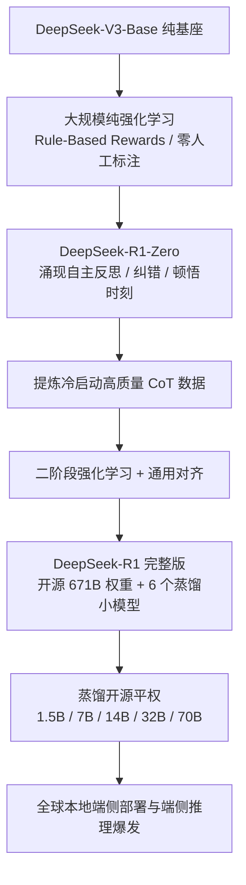

# 第六章：深度推理与后训练强化革命 (2024 末 - 2025/2026) —— 从预训练尺度到推理期算力缩放

> **核心主题**：数据墙危机、System 1 到 System 2 认知跃迁、推理期计算扩展（Test-Time Compute Scaling）、OpenAI o1/o3、DeepSeek-V3/R1 全球风暴与纯 RL 涌现。

---

## 1. 范式拐点：预训练红利放缓与 System 2 觉醒

自 2020 年以来驱动大模型狂飙突进的“预训练扩展法则（Pre-training Scaling Laws）”在 2024 年下半年遭遇了多重严峻挑战：

1. **“数据墙（The Data Wall）”逼近**：根据 Epoch AI 等机构预测，人类互联网上积累的高质量未标注自然语言文本（约数十万亿 Token）几乎已被各大科技巨头完全吸干。合成数据（Synthetic Data）的大规模注入又容易引发“模型崩溃（Model Collapse）”与近亲繁殖导致的自闭退化。
2. **边际效益递减（Diminishing Returns）**：将预训练集群从万卡扩展到十万卡集群，训练成本指数级飙升至数亿美元，但在基础语言理解和常识测试上的提升曲线已逐渐趋于平缓。
3. **快思考（System 1）与慢思考（System 2）之分**：
   - 传统自回归模型本质上是**快思考（System 1 直觉模式）**：不管问题多么艰深（如国际数学奥林匹克证明题），模型每次只在固定的前向计算时间内预测下一个 token，没有“停下来深思熟虑、草稿演算、自我验证与回溯纠错”的机制；
   - 复杂推理需要**慢思考（System 2 审慎模式）**：必须允许模型在给出最终答案之前，进行动态、自适应的思维链展开、逻辑推演、分支探索和自我批判。

```
           前向传播 (System 1: 直觉续写)
   Prompt ──────────────────────────────────────────► Output (容易犯逻辑跳跃与幻觉)

           推理期计算 (System 2: 审慎慢思考)
                      ┌─── 步骤 1: 问题解构与假设 ──┐
                      ├─── 步骤 2: 尝试推导与试错 ──┤
   Prompt ───────────►├─── 步骤 3: 发现矛盾并回溯 ──┼──► Output (高度可信严谨)
                      └─── 步骤 4: 交叉检验与收敛 ──┘
                             (Test-Time Compute Scaling)
```

---

## 2. 破冰之作：OpenAI o1 与 o3 (2024.09 - 12)

2024 年 9 月 12 日，OpenAI 正式发布代号为 **Strawberry（草莓）** 的推理模型系列：**o1-preview 与 o1-mini**，随后在 12 月发布更强的 **o3 / o3-mini**。

### 2.1 核心理论：推理期计算扩展法则 (Test-Time Compute Scaling)

OpenAI 揭示了全新的第三维度尺度定律：**不仅在预训练阶段增加计算量可以提高模型性能，在推理阶段（Inference/Test-Time）投入更多的计算时间与 Token 生成量，模型的逻辑推理准确率同样严格遵循对数线性提升规律！**

$$\text{Accuracy} \propto f(\text{Test-Time Compute FLOPs})$$

### 2.2 核心机制：大规模强化学习与隐式思维链 (Hidden CoT)

- **强化学习搜索**：利用高度可验证的规则环境（如可执行的编译器代码测试集、具有唯一标准答案的数学公式），通过大规模 RL 训练模型如何在隐式思维空间中开展树搜索（MCTS）、自我质疑和回溯修正。
- **竞赛级人类巅峰表现**：
  - 在国际数学奥林匹克竞赛资格赛（AIME 2024）中，o1 的解题准确率达到 **83.3%**（此前 GPT-4o 仅为 13.4%），o3 更是达到了 **96.7%**（金牌水准）；
  - 在竞争性编程平台 Codeforces 上，达到 **89% 百分位（特级大师水平）**；
  - 在物理、化学、生物学博士水准问题集（GPQA Diamond）上首次全面超越人类专家基准。
- **争议**：OpenAI 隐藏了 o1 的原生思维链（Raw CoT），声称出于安全原因及防止竞品抓取思维链蒸馏，向用户展示的仅是经二级总结的粗略摘要。

---

## 3. 极致工程基石：DeepSeek-V3 的震撼发布 (2024.12)

2024 年 12 月 26 日，DeepSeek 团队发布了全尺寸基座大模型 **DeepSeek-V3**，总参数 **6710 亿（671B）**，每个 token 激活 **370 亿（37B）**。

其在自然语言处理、多语言理解与通用代码基准上全面打平甚至超越 Claude 3.5 Sonnet 与 GPT-4o，但最令全球半导体与算力工业界震撼的是其**近乎奇迹的工程能效比**：

```
DeepSeek-V3 核心工程指标：
- 训练算力：仅耗费约 278.8 万 H800 GPU 运行时长 (约 2048 块 GPU 训练 2 个月)
- 训练总费用：仅为 557.6 万美元 (约合人民币 4000 万元)
  对比：业界同级别模型预训练成本普遍在上千万乃至数亿美元！
```

### 3.1 核心技术突破矩阵

1. **FP8 混合精度低比特全流程训练**：
   - 解决了深度神经网络全链路采用 8 位浮点数（FP8）训练时常见的下溢与梯度溢出难题；
   - 提出基于细粒度瓦片（Tile-wise）和块级（Block-wise）的动态缩放因子量化方案，使 GEMM（通用矩阵乘法）运算速度提升近一倍，激活状态显存占用减半。
2. **DualPipe 双流水线通信与计算重叠（Overlap）**：
   - 在跨节点分布式训练中，将前向传播、后向传播与 All-to-All 专家通信管道深度交叉重叠，实现了**近乎 100% 的通信开销隐藏（Zero Bubble Overhead）**。
3. **多 Token 预测（Multi-Token Prediction, MTP）**：
   - 模型在每个推理步不仅仅预测下一个 token，而是联合预测后续的多个 token（例如额外预测未来 2 个 token），极大加快了训练速度，并在推理部署时天然支持投机解码（Speculative Decoding），使生成速度翻倍。

---

## 4. 全球范式海啸：DeepSeek-R1 与纯强化学习涌现 (2025.01)

2025 年 1 月 20 日，DeepSeek 发布 **DeepSeek-R1** 及其技术白皮书《Incentivizing Reasoning Capability in LLMs via Reinforcement Learning》。

这一事件被全球媒体与学界称为 **“大模型领域的斯普特尼克时刻（Sputnik Moment）”**：



### 4.1 颠覆性实验：DeepSeek-R1-Zero 的纯强化学习探索

DeepSeek-R1-Zero 彻底跳过了传统的“监督微调冷启动（Supervised Fine-Tuning, SFT）”，直接在基座模型上应用大规模强化学习算法（**GRPO: Group Relative Policy Optimization**，移除了昂贵的 Critic 评价网络，利用分组样本相对分数计算优势函数）：

- **零人工干预奖励（Zero Human Preference）**：
  - 仅采用确定性规则奖励：
    1. **准确性奖励（Accuracy Reward）**：数学答案是否与真值完全匹配？代码能否通过编译并在预设测试用例中跑通？
    2. **格式奖励（Format Reward）**：思考过程是否严谨地封装在 `<think>` 和 `</think>` 标签内。
- **顿悟时刻（Aha Moment）与行为涌现**：
  在数万步的纯强化学习进化中，没有人类教导任何解题套路，模型自发演化出了：
  - **自主反思（Self-Reflection）**：“等一下，让我重新计算一下前一步的判别式，我好像忽略了一个边界条件……”
  - **长程探索与回溯验证（Backtracking & Verification）**；
  - **自发增加思考时长（Thinking Length Expansion）**：随着训练进行，模型在复杂难题上的思考步数从数百词自发增长到数万词。

### 4.2 开源全权与蒸馏赋能

不同于 OpenAI 对 o1 权重的深锁与思维链的屏蔽，DeepSeek 做到了**彻底的开源共享**：
1. **全尺寸权重与训练报告无保留公开**；
2. **知识蒸馏（Distillation）小模型全面开源**：利用 R1 生成的高质量长推理轨迹，将推理能力蒸馏至 Qwen-2.5（1.5B、7B、14B、32B）和 LLaMA-3.1（8B、70B）六个小模型上。
   - 蒸馏后的 **DeepSeek-R1-Distill-Qwen-32B** 在多个数学和代码基准上直接超越了未蒸馏的 OpenAI o1-mini！
3. **全球经济与地缘冲击**：
   - DeepSeek 的发布引发美股半导体板块剧震（英伟达单日市值蒸发超数千亿美元）；
   - 彻底击碎了“大模型只有依赖万卡万亿美金闭源算力才能做到极致”的行业神话，证明了**顶尖的系统工程与算法第一性原理探索可以跨越算力封锁鸿沟**。

---

## 5. 2024-2025 年代的前沿生态群星

在 o1 与 R1 开辟的推理期算力缩放新纪元中，全球顶尖阵营展开了前沿技术体系的重构：

### 5.1 美国前沿动态

1. **Anthropic: Claude 3.5 Sonnet (New) & Claude 3.7**：
   - 引入 **Computer Use（自主计算机操控）**：赋予模型通过屏幕视觉截图、移动鼠标、键盘点击操作真实操作系统界面的 Agent 能力；
   - 推出 **混合推理（Hybrid Reasoning / Extended Thinking）**，支持开发者自由控制思考预算，并在单次调用中兼顾快速响应与深度推理；
   - 推出并开源 **Model Context Protocol (MCP)**，成为大模型跨工具、跨数据源连接的现代事实标准协议。
2. **Google: Gemini 2.0 (2024.12 - 2025)**：
   - **Gemini 2.0 Flash / Flash Thinking**：原生支持实时视觉、语音与慢思考推理；
   - Project Astra 智能体形态全方位推进。
3. **xAI: Grok-2 & Grok-3 (Elon Musk)**：
   - 在美国田纳西州孟菲斯建立“Colossus（巨人）”超级计算集群（部署超过 10 万张英伟达 H100/H200 GPU）；
   - 凭借强劲的单点算力优势迅速追平全球 Frontier 模型基准。

### 5.2 中国前沿动态

1. **阿里巴巴：通义千问 QwQ & Qwen 2.5-Max (2024.11 - 2025.01)**：
   - 推出专注深度推理的 **QwQ-32B-Preview** 与新一代稠密旗舰 **Qwen 2.5-Max**，在权威基准上追平 Claude 3.5 Sonnet 与 GPT-4o。
2. **月之暗面：Kimi k1.5 (2025.01)**：
   - 推出支持长程多模态慢思考与规划推理的 k1.5 模型，具备高阶数学推导与复杂视觉图表逆向分析能力。
3. **智谱 AI、字节跳动与腾讯**：
   - **智谱 GLM-4-Voice / GLM-Zero-Preview**：开源端到端全双工实时语音大模型与慢思考探索版；
   - **字节跳动豆包（Doubao 1.5 Pro）**：日均处理 Token 量突破万亿级，成为中国应用落地体量最大的企业级主力基座之一；
   - **腾讯混元 Large（Hunyuan-Large, 2024.11）**：总参数 389B 的 MoE 开源巨模。

---

## 6. 本阶段核心里程碑对比表 (2024 末 - 2025/2026)

| 模型名称 | 机构/国家 | 发布时间 | 开源状态 | 架构特性与参数 | 核心突破与全球影响 |
| :--- | :--- | :--- | :--- | :--- | :--- |
| **OpenAI o1** | OpenAI (美) | 2024.09 | 闭源 API | 推理期强化学习 (隐式 CoT) | 确立 Test-Time Compute Scaling 理论，博士级竞赛理科突破 |
| **Claude 3.5 (New)** | Anthropic (美) | 2024.10 | 闭源 API | 密集型 / 引入 Computer Use | 计算机屏幕自主操控能力突破，发布 MCP 协议标杆 |
| **QwQ-32B** | 阿里巴巴 (中) | 2024.11 | 开源可商用 | 32B 推理分支架构 | 中国首个高质量开源慢思考推理尝试 |
| **Gemini 2.0 Flash**| Google (美) | 2024.12 | 闭源 API | 原生多模态 + 实时流式响应 | 毫秒级端到端音视频多模态 Agent 体验 |
| **DeepSeek-V3** | DeepSeek (中) | 2024.12 | 权重开源 | 671B MoE (激活 37B), FP8 | 557 万美元极低预训练成本挑战万亿算力神话，DualPipe/MTP 标杆 |
| **OpenAI o3** | OpenAI (美) | 2024.12 | 闭源 API | 极致推理期强化搜索 | AIME 96.7% 近乎满分，前沿数学与代码天花板 |
| **DeepSeek-R1** | DeepSeek (中) | 2025.01 | 权重/蒸馏全开源 | 671B MoE, GRPO 纯强化探索 | 证实纯 RL 自主涌现反思与思维链，彻底引发全球算力与技术平权震动 |
| **Kimi k1.5** | 月之暗面 (中) | 2025.01 | 闭源 API | 多模态长程强化推理 | 兼顾超长文本记忆与复杂多步多模态逻辑规划 |
