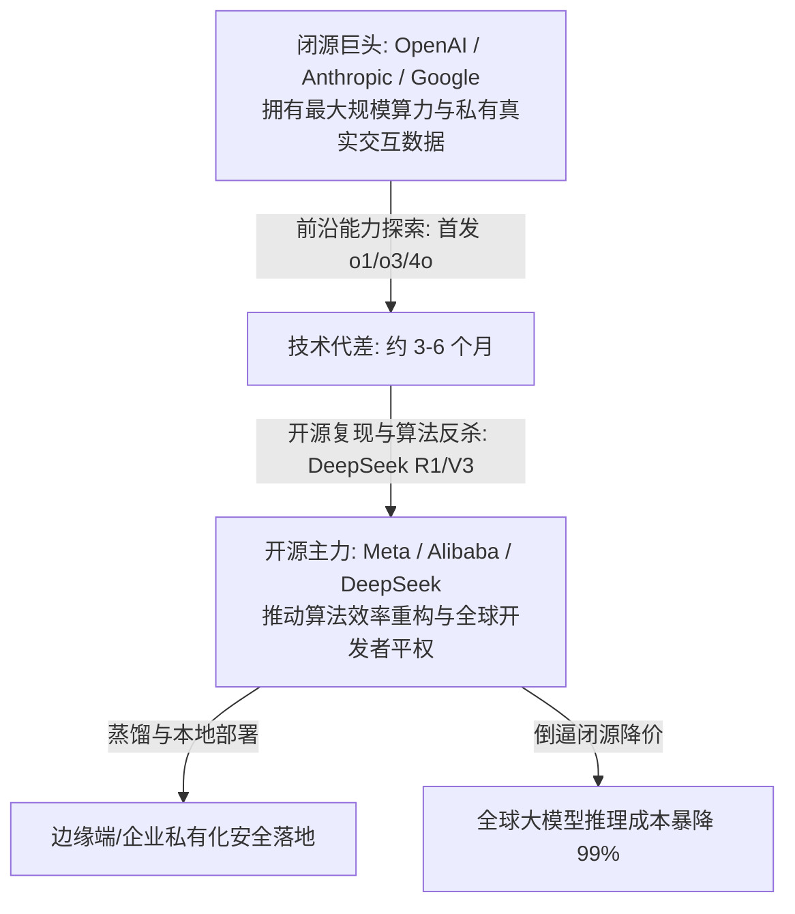

# 第七章：全球竞争图谱：中美双雄与开源/闭源演进矩阵

> **核心主题**：中美大模型生态全景对比、顶级科技巨头与明星创企战略路径、开源（Open Weights）与闭源商业帝国（Proprietary API）博弈演进。

---

## 1. 中美大模型战略生态对比：算力鸿沟与工程突破

全球大模型的竞技场本质上呈现为**中美双极领跑、欧洲特色跟随（如 Mistral）**的战略格局。然而，两国的演进驱动力、资源约束与产业形态呈现出鲜明的结构性差异：

```
                    中美大模型核心特征矩阵对比

        维度                      美国阵营 (US)                    中国阵营 (CN)
───────────────────────────────────────────────────────────────────────────────
 核心驱动力        第一性原理科学探索、算法先发优势、资本高冗余    系统工程极度优化、算法效率突破、应用场景纵深
 算力基础设施      10万+ 卡 H100/B200 超算集群 (Colossus 等)    算力供给受限环境，深挖单卡利用率与架构降耗 (MLA/FP8)
 商业变现路径      云算力绑定 (Azure/AWS/GCP)、企业 API、SaaS    国民级超级 App 原生重塑、极低成本 API、私有化部署
 开源贡献力量      Meta (LLaMA 系列领头羊)                       Alibaba (Qwen 全栈矩阵)、DeepSeek (全尺寸/蒸馏平权)
 闭源领跑阵营      OpenAI、Anthropic、Google                     百度、字节跳动、月之暗面、智谱 AI (兼顾开源)
```

---

## 2. 美国主要大模型企业与模型家族谱系

### 2.1 OpenAI：生成式 AI 的开创者与前沿探索者

OpenAI 经历了从“非营利学术实验室”到“科技商业巨无霸”的转型，始终在算法原理突破与 Scaling Laws 上扮演拓荒者角色：

- **迭代谱系**：
  - `GPT-1 (2018.06)`：117M，确立预训练+微调范式（开源）。
  - `GPT-2 (2019.02)`：1.5B，提出零样本多任务泛化能力（分阶段开源）。
  - `GPT-3 (2020.05)`：175B，提出 In-Context Learning，正式转向闭源商业 API。
  - `InstructGPT / ChatGPT (2022.03/11)`：引入 RLHF，消费级引爆。
  - `GPT-4 (2023.03)`：万亿级稀疏 MoE，确立多模态理解基准。
  - `GPT-4o (2024.05)`：原生端到端统一文本、音频、视觉，实时低延迟互动。
  - `o1 / o3 系列 (2024.09 - 12)`：开创 Test-Time Compute 强化学习慢思考时代。
- **商业模式**：与微软深度绑定（Microsoft Azure 独家云合作与 Office Copilot 赋能），通过 ChatGPT Plus 订阅与开发者 API 变现。

### 2.2 Google / DeepMind：Transformer 的发源地与全栈反攻者

Google 是现代深度学习底座（Transformer, Attention, T5, BERT, TPU 芯片）的真正奠基者。2023 年将 Google Brain 与 DeepMind 强强合并为 Google DeepMind，构建了全栈自研的生态闭环：

- **迭代谱系**：
  - `BERT / T5 (2018-2019)`：开源自然语言理解标准。
  - `Chinchilla / PaLM (2022)`：修正尺度定律，推出 540B 密集型基座。
  - `LaMDA / Bard (2023.02)`：紧急应对 ChatGPT 的防御性对话服务，后历经事实性幻觉阵痛与架构换代。
  - `Gemini 1.0 (2023.12)`：Nano / Pro / Ultra 规格，重塑原生多模态。
  - `Gemini 1.5 Pro (2024.02)`：100万-200万 Token 超长上下文检索 SOTA。
  - `Gemma 系列 (2024)`：轻量化开源权重，回馈全球开源开发者。
  - `Gemini 2.0 (2024.12)`：Flash / Thinking 多模态 Agent 新旗舰。
- **核心优势**：自研 TPU（TPU v4/v5p/v6e）算力独立自主，无需受制于外部芯片供应链；具备搜索、YouTube、Android 等无可比拟的丰富多模态语料库。

### 2.3 Meta：全球开源大模型的中流砥柱

在扎克伯格（Mark Zuckerberg）与杨立昆（Yann LeCun）领导下，Meta 采取了颠覆性的“全面开源战略”，旨在粉碎专有闭源护城河，让全球开发者共同分摊安全与生态维护成本：

- **迭代谱系**：
  - `LLaMA 1 (2023.02)`：7B-65B，学术开源引发全球量化与微调革命。
  - `LLaMA 2 (2023.07)`：7B-70B，放开商用许可，引入 GQA。
  - `LLaMA 3 (2024.04)`：8B-70B，15T Token 巨量预训练。
  - `LLaMA 3.1 (2024.07)`：405B，首个匹敌闭源顶流的超大规模开源权重。
  - `LLaMA 3.2 (2024.09)`：轻量级多模态（1B/3B 端侧 + 11B/90B 视觉）。
- **战略目的**：将模型层商品化（Commoditization），保护其社交广告与沉浸式元宇宙硬件生态的核心商业利益。

### 2.4 Anthropic：AI 安全、代码编程与企业级信誉之王

由前 OpenAI 核心研发成员出走创立，获得亚马逊（AWS）与谷歌数十亿美元战略投资：

- **迭代谱系**：
  - `Claude 1 & 2 (2023)`：率先支持 100k 上下文，主打 Constitutional AI。
  - `Claude 3 系列 (2024.03)`：Haiku / Sonnet / Opus 三级矩阵，Opus 挑落 GPT-4。
  - `Claude 3.5 Sonnet (2024.06)`：在全球代码生成与学术基准登顶，成为开发者公认的最强编程大模型。
  - `Computer Use & MCP (2024.10)`：率先支持计算机界面直接操控，开源 Model Context Protocol 协议。
- **核心定位**：极度注重可靠性、可解释性与安全对齐，成为全球高端企业与金融/法律机构的首选闭源引擎。

### 2.5 微软 (Microsoft)：搜索入口革命、Copilot 生态与小模型 (SLM) 先驱

微软在整个大模型周期中采取了独特的“**外部资本同盟 + 内部平台集成 + 前沿小模型自研**”三位一体战略：

- **搜索与浏览器白刃战（New Bing 与 Prometheus 架构）**：
  - 2023 年 2 月突袭发布 New Bing，以内部尚未公开的 GPT-4 早期基座搭载 Prometheus 编排器，首次打通大模型与实时网页倒排索引的动态连接，确立了全球商业级检索增强生成（Web-grounded RAG）的先河。
- **全线重构 Copilot 生态**：
  - 依托 Windows 操作系统与 Office 办公套件（Word、Excel、PowerPoint、Teams）数十亿用户基础，将大模型包装为统一的“Copilot”助手，成为全球最早跑通大模型 C 端与 B 端软件订阅分发闭环的巨头。
- **小语言模型（SLM）第一性原理：Phi 系列**：
  - 提出“Textbooks Are All You Need”哲学，研发开源 **Phi-1、Phi-2、Phi-3、Phi-4 系列**。通过极高质量教材级合成数据（Synthetic Data）预训练，证明 1B-3B 级别的极小模型也能拥有媲美 10 倍以上大模型的逻辑推理能力，开创了边缘端与本地算力高效运行的 SLM 细分赛道。

### 2.6 xAI：马斯克的十万卡超算与实时激进派

由埃隆·马斯克（Elon Musk）于 2023 年 7 月创立，以激进的工程推进速度著称：

- **迭代谱系**：
  - `Grok-1 (2023.11)`：总参数 314B 的稀疏 MoE 基础权重，2024 年 3 月宣布完全开源权重。
  - `Grok-2 & Grok-3 (2024 - 2025)`：基于田纳西州孟菲斯建立的“Colossus（巨人）”超算集群（部署超过 10 万张英伟达 H100/H200 GPU），直连 X 平台海量实时网络对话数据，在各项前沿基准测试中逼平一线顶流闭源模型。
- **战略定位**：追求对世界底层真实规律的无偏见探寻（Truth-seeking AI），拥有全球单集群物理算力的最高纪录之一。

---

## 3. 中国主要大模型企业与机构谱系

### 3.1 深度求索 (DeepSeek)：算法效率与全球破局者

中国量化背景团队，凭借极致的第一性原理思考与顶级系统工程能力，打破“参数算力崇拜”：

- **迭代谱系**：
  - `DeepSeek-LLM / Coder (2023.11)`：首创高质量中文代码与数学基座。
  - `DeepSeek-Math (2024.02)`：GRPO 早期探索，刷新开源数学推理 SOTA。
  - `DeepSeek-V2 (2024.05)`：提出 MLA 注意力机制与 DeepSeekMoE，降显存 93%，引爆降价潮。
  - `DeepSeek-V3 (2024.12)`：671B MoE 全面开源，FP8 训练，以 557 万美元极低成本训练出世界顶流基座。
  - `DeepSeek-R1 (2025.01)`：纯 RL 激发自发顿悟，671B 权重与多尺寸蒸馏模型全开源，重塑全球科技格局。

### 3.2 阿里巴巴 (通义千问 Qwen)：中国开源生态主力军

阿里巴巴依托阿里云全球算力网络，坚定推进“全尺寸全场景”开源生态：

- **迭代谱系**：
  - `Qwen-7B / 14B / 72B (2023.08 - 11)`：全面开源，迅速夺得各大排行榜前席。
  - `Qwen 1.5 & Qwen 2 (2024.02 - 06)`：覆盖 0.5B 到 72B，支持稠密与 MoE 架构。
  - `Qwen 2.5 系列 (2024.09)`：18T 语料重塑，在编程（Qwen2.5-Coder）、数学（Qwen2.5-Math）领域成为全球开源标杆。
  - `QwQ-32B & Qwen 2.5-Max (2024.11 - 2025.01)`：发力慢思考与千亿闭源超级旗舰。

### 3.3 智谱 AI (Zhipu AI)：清华技术基底与全模态先锋

脱胎于清华大学 KEG 实验室，中国大模型技术底蕴最深厚的技术先锋之一：

- **迭代谱系**：
  - `GLM-130B (2022)`：国内最早突破千亿参数的自研双向掩码预训练模型。
  - `ChatGLM-6B (2023.03)`：开启单张消费级显卡本地跑大模型的全民普及潮。
  - `GLM-4 / GLM-4V (2024.01)`：全面对标 GPT-4 级全功能智能体，涵盖长文本、视觉与工具调用。
  - `CogVideoX / GLM-4-Voice (2024.08 - 10)`：开源顶尖视频生成与端到端全双工实时语音。

### 3.4 月之暗面 (Moonshot AI)：超长上下文与极致产品感知

清华杨植麟团队创立，以长文本技术差异化破局：

- **迭代谱系**：
  - `Kimi Chat 200k (2023.10)`：中国长文本普及的引爆点。
  - `Kimi 200万字内测 (2024.03)`：引发行业“长文本大战”。
  - `Kimi k1.5 (2025.01)`：探索长程多模态慢思考与强化学习规划。

### 3.5 百度 (文心一言 ERNIE)：产业全栈与企业级落地

- **迭代谱系**：
  - `ERNIE 1.0 - 3.0 (2019 - 2021)`：知识增强特色预训练模型。
  - `文心一言 3.5 (2023.03)`：中国首个正式发布的商业级对话大模型。
  - `文心大模型 4.0 (2023.10)`：闭源升级，全面重构百度全线搜索与应用业务。

### 3.6 字节跳动、腾讯、百川、零一万物与 MiniMax

- **字节跳动（豆包 / 云雀）**：依靠极致吞吐降本与庞大国民应用流量（抖音、剪映、飞书），日均 Token 消费量居国内第一梯队。
- **腾讯（混元 Hunyuan）**：主打自研与超大混合专家，开源 `Hunyuan-Large (389B MoE)`，深度赋能微信与腾讯会议生态。
- **零一万物 (01.AI)**：李开复创立，`Yi-34B` 曾登顶开源榜首，深耕大模型基础设施优化。
- **MiniMax (稀宇科技)**：早期即押注 MoE 架构（`abab 6.5`），在端到端语音拟真与虚拟角色社交上形成鲜明技术特色。
- **百川智能 (Baichuan)**：王小川创立，开源与医疗专业模型双线并进。

---

## 4. 开源 vs 闭源：生态博弈与演进周期律

在整部大模型发展史中，开源与闭源从未像今天这样深度互搏又高度共生：



### 4.1 开源与闭源的代差周期定律

1. **“3-6 个月代差收敛”**：
   - 2023 年初，GPT-4 与开源 LLaMA 1 之间的差距长达 1 年以上；
   - 到了 2024 年，Meta LLaMA 3.1 405B、Qwen 2.5 72B 将开源与顶尖闭源模型的距离缩小到数个月内；
   - 2025 年初，DeepSeek-R1 更是以惊人速度开源复现并超越了闭源 o1-preview 的推理表现。
2. **数据与能力反哺（Distillation Economy）**：
   - 开源社区利用顶级闭源 API 生成的高质量合成数据与思维链，通过**知识蒸馏（Knowledge Distillation）**快速提升中小开源模型的能力，使得模型小型化与本地化部署成本急剧下探。
3. **企业端采用的不可逆分化**：
   - **闭源核心领地**：前沿多模态探索、极度复杂的智能体工作流、零运维要求的企业消费场景；
   - **开源核心领地**：涉及核心金融数据、医疗健康、国防军工、代码知识库等对**数据隐私、主权可控与本地私有部署**有硬性要求的企业核心场景。

---

## 5. 中美主要模型与企业全景速查对照矩阵

| 企业 / 机构 | 国家 | 代表模型系列 | 开放形态 | 训练芯片生态 | 核心定位与技术壁垒 |
| :--- | :---: | :--- | :--- | :--- | :--- |
| **OpenAI** | 美 | GPT-1~4o, o1, o3 | 闭源 API (早期开源) | NVIDIA / Azure 超算 | 前沿尺度定律拓荒者，逻辑推理与强化学习领航 |
| **Google** | 美 | T5, PaLM, Bard, Gemini 1.5/2.0, Gemma | 闭源 API + 部分开源 | 自研 TPU v4/v5/v6 | Transformer 发明者，自研全栈硬件，原生多模态 |
| **Meta** | 美 | LLaMA 1, 2, 3, 3.1, 3.2 | 开放权重 (Open Weights) | NVIDIA GPU 万卡集群 | 全球开源领袖，重构大模型基础设施与工具链 |
| **Anthropic**| 美 | Claude 1~3.7 Sonnet/Opus | 闭源 API | AWS Trainium / NVIDIA | 宪政 AI，代码生成与计算机视觉操控第一名 |
| **xAI** | 美 | Grok-1 (开源), Grok-2/3 | 开源+闭源 | 10万卡 Colossus 集群 | 拥有单集群最大卡数，实时社交数据驱动 |
| **Microsoft**| 美 | New Bing, Copilot, Phi-1~4 | 开源小模型 + 闭源服务 | Azure / 自研 Maia / NVIDIA | Prometheus 搜索编排，商业 RAG 标杆，高质量合成数据小模型先锋 |
| **DeepSeek** | 中 | DeepSeek-V1~V3, R1 | 开放权重 + 极低价 API | NVIDIA 集群 (工程极致) | MLA 显存优化，FP8 训练，纯 RL 顿悟涌现，全球颠覆 |
| **阿里巴巴** | 中 | 通义千问 Qwen 1~2.5, QwQ | 开放权重 + 闭源云 API | 阿里云集群 + 倚天芯片 | 中国开源第一阵营，尺寸最全，Coder/Math 领跑 |
| **智谱 AI** | 中 | ChatGLM 1~3, GLM-4, CogVideo | 开源 + 闭源商业化 | 国产芯片适配 + NVIDIA | 清华 KEG 渊源，单卡低显存部署普及者，全模态布局 |
| **月之暗面** | 中 | Kimi Chat, Kimi k1.5 | 闭源应用 + 闭源 API | 公有云集群 | 中国超长文本先驱，多模态慢思考与长程规划 |
| **百度** | 中 | ERNIE 文心 1.0~4.0 | 闭源服务 + 云 API | 百度飞桨 + 昆仑芯/NVIDIA | 知识增强预训练，软硬一体协同，国内产业渗透广泛 |
| **字节跳动** | 中 | 豆包 (云雀), 豆包 1.5 Pro | 闭源服务 + 火山引擎 API | 超大规模集群 | 超级 App 原生赋能，日均 Token 消费天花板，极低推理成本 |
| **腾讯** | 中 | 混元 Hunyuan, Hunyuan-Large | 闭源服务 + 核心开源 | 腾讯云集群 | 389B MoE 开源巨模，深度集成微信与数字娱乐生态 |
| **零一万物** | 中 | Yi-6B/34B, Yi-Large | 开源权重 + 闭源 API | 混合算力 | 高度注重预训练数据清洗质量，多次登顶全球开源榜 |
| **MiniMax** | 中 | abab 5/6/6.5, 拟真音频/视频 | 闭源 API + 移动应用 | 混合算力 | 早期押注 MoE 架构，语音合成拟真度与沉浸交互突出 |
