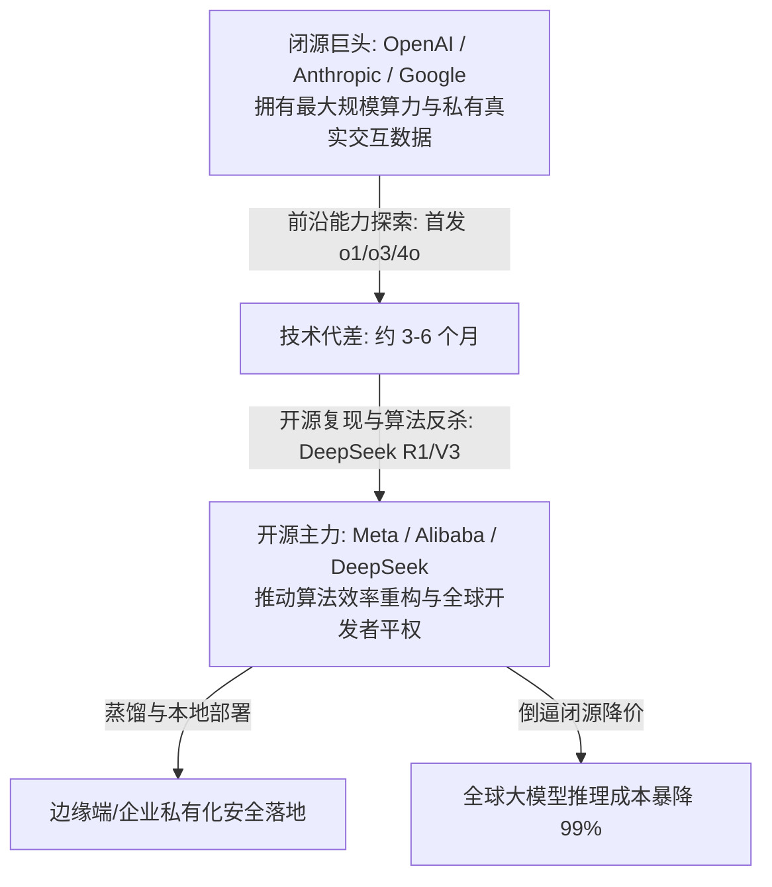

# 第七章：全球竞争图谱：中美双雄与开源/闭源演进矩阵

> **核心主题**：中美大模型生态全景对比、顶级科技巨头与明星创企战略路径、开源（Open Weights）与闭源商业帝国（Proprietary API）博弈演进。

---

## 1. 中美大模型战略生态对比：算力鸿沟与工程突破

全球大模型的竞技场本质上呈现为**中美双极领跑、欧洲特色跟随（如 Mistral、Aleph Alpha）**的战略格局。然而，两国的演进驱动力、资源约束与产业形态呈现出鲜明的结构性差异：

```
                    中美大模型核心特征矩阵对比

        维度                      美国阵营 (US)                    中国阵营 (CN)
───────────────────────────────────────────────────────────────────────────────
 核心驱动力        第一性原理科学探索、算法先发优势、资本高冗余    系统工程极度优化、算法效率突破、应用场景纵深
 算力基础设施      10万+ 卡 H100/B200 超算集群 (Colossus 等)    算力供给受限环境，深挖单卡利用率与架构降耗 (MLA/FP8)
 商业变现路径      云算力绑定 (Azure/AWS/GCP)、企业 API、SaaS    国民级超级 App 原生重塑、极低成本 API、私有化部署
 开源贡献力量      Meta (LLaMA 系列领头羊)                       Alibaba (Qwen 全栈矩阵)、DeepSeek (全尺寸/蒸馏平权)
 闭源领跑阵营      OpenAI、Anthropic、Google                     百度、字节跳动、月之暗面、智谱 AI (兼顾开源)
```

---

## 2. 美国主要大模型企业与模型家族谱系

### 2.1 OpenAI：生成式 AI 的开创者与前沿探索者

OpenAI 经历了从“非营利学术实验室”到“科技商业巨无霸”的转型，始终在算法原理突破与 Scaling Laws 上扮演拓荒者角色：

- **完整迭代谱系**：
  - `GPT-1 (2018.06)`：117M，确立预训练+微调范式（开源）。
  - `GPT-2 (2019.02)`：1.5B，提出零样本多任务泛化能力（分阶段开源）。
  - `GPT-3 (2020.05)`：175B，提出 In-Context Learning，正式转向闭源商业 API。
  - `InstructGPT / ChatGPT (2022.03/11)`：引入 RLHF 与 PPO，消费级交互全面引爆。
  - `GPT-3.5 Turbo (2023.03)`：低成本高吞吐后端，支持 Function Calling，开启大模型开发范式。
  - `GPT-4 (2023.03)`：万亿级稀疏 MoE，确立多模态理解基准。
  - `GPT-4 Turbo (2023.11)`：128K 上下文、更新知识库截止点、价格直降 3 倍。
  - `GPT-4o (2024.05)`：原生端到端统一文本、音频、视觉，实时低延迟语音交互。
  - `GPT-4o mini (2024.07)`：极致性价比小模型，全面取代 GPT-3.5 Turbo。
  - `o1-preview / o1-mini (2024.09)`：首批公开预览版推理模型，公开验证 Test-Time Compute 慢思考。
  - `o1 / o3 系列 (2024.12 - 2025.01)`：正式版完整 o1 与 o3-mini（三档推理力度），刷新数学与竞技编程记录。
  - `GPT-4.1 / mini (2025.04)`：百万 Token（1M context）长程编码工程专精版。
  - `o3-pro (2025.06)`：ChatGPT Pro 专属最高推理版本，解决高难度学术与科学攻关。
  - `GPT-5 (2025.08)`：推理与对话内生大一统，根据任务隐式复杂度自适应触发思考。
  - `gpt-oss (2025.08)`：通过 Ollama 等渠道开放的部分本地部署蒸馏权重 (20b/120b)。
  - `GPT-5.6 (2026.07)`：确立 Luna（轻量）、Terra（主力）、Sol（科研推理）三档家族。
  - `GPT-6 / 6.1 (2026.10)`：跨模态因果演化与自主智能体深度重构。
- **商业模式**：与微软深度绑定（Microsoft Azure 独家云合作与 Office Copilot 赋能），通过 ChatGPT Plus 订阅与开发者 API 变现。

### 2.2 Google / DeepMind：Transformer 的发源地与全栈反攻者

Google 是现代深度学习底座（Transformer, Attention, T5, BERT, TPU 芯片）的真正奠基者。2023 年将 Google Brain 与 DeepMind 强强合并为 Google DeepMind，构建了全栈自研的生态闭环：

- **完整迭代谱系**：
  - `BERT / T5 (2018-2019)`：开源自然语言理解与统一序列到序列标准。
  - `Chinchilla / PaLM (2022)`：修正尺度定律，推出 540B 密集型基座。
  - `LaMDA / Bard (2023.02)`：紧急应对 ChatGPT 的防御性对话服务，后历经事实性幻觉阵痛与架构换代。
  - `Gemini 1.0 (2023.12)`：Nano / Pro / Ultra 规格，重塑原生多模态底座。
  - `Gemini 1.5 Pro / Flash (2024.02/05)`：100万-200万 Token 超长上下文检索 SOTA，Flash 确立轻量低延迟标准。
  - `Gemma 系列 (2024 - 2026)`：从 Gemma 1/2 到 Gemma 4 家族（E2B/E4B/12B/26B），提供端侧极速开放权重。
  - `Gemini 2.0 (2024.12)`：Flash / Thinking 多模态 Agent 新旗舰。
  - `Gemini 3 Pro / Flash (2026)`：能效比与推理吞吐大幅升级。
  - `Gemini 4 系列 (2026 GA)`：推出 Hydrogen（超轻）、Carbon（主力）、Argon（重型科研）三态化算力矩阵。
  - `Gemini Omni 1.2 Flash (2026.11)`：原生超低延迟多模态视频交互。
  - `Gemini Robotics 2 (2026.07)`：全身协调具身智能（Whole-Body Intelligence）通用基座。
- **核心优势**：自研 TPU（TPU v4/v5p/v6e）算力独立自主，无需受制于外部芯片供应链；具备搜索、YouTube、Android 等无可比拟的丰富多模态语料库。

### 2.3 Meta：全球开源大模型领袖及其历史性路线分化

在扎克伯格（Mark Zuckerberg）与杨立昆（Yann LeCun）领导下，Meta 曾长期采取颠覆性的“全面开源战略”。但在 2025-2026 年，Meta 迎来了重大的路线分化转折：

- **完整迭代谱系**：
  - `LLaMA 1 (2023.02)`：7B-65B，学术开源引发全球量化与微调革命。
  - `LLaMA 2 (2023.07)`：7B-70B，放开商用许可，引入 GQA 降低显存占用。
  - `LLaMA 3 (2024.04)`：8B-70B，15T Token 巨量预训练与全新 Tokenizer。
  - `LLaMA 3.1 (2024.07)`：405B，首个匹敌闭源顶流的超大规模开源权重。
  - `LLaMA 3.2 (2024.09)`：轻量级多模态（1B/3B 端侧 + 11B/90B 视觉）。
  - `Llama 4 (Scout / Maverick, 2025 - 2026)`：维持开放权重，作为开源阵营中坚主力。
  - `★ 历史性大转折：Avocado (2026 Q1)`：作为原定 Llama 5 继任者，Meta 面对高昂算力成本与回报压力，**正式将 Avocado 转向闭源商业化 API 模式**，引发全球开源生态对单一商业巨头依赖的反思。
- **战略演进**：从单纯的模型层商品化（Commoditization），演进至开源防御与核心前沿闭源变现双轨运行。

### 2.4 Anthropic：AI 安全、代码编程与企业级信誉之王

由前 OpenAI 核心研发成员（Dario Amodei 等）出走创立，获得亚马逊（AWS）与谷歌数十亿美元战略投资：

- **完整迭代谱系**：
  - `Claude 1.0 & 2 / 2.1 (2023)`：率先支持 100k-200k 上下文，主打 Constitutional AI。
  - `Claude 3 系列 (2024.03)`：Haiku / Sonnet / Opus 三级矩阵，Opus 挑落 GPT-4。
  - `Claude 3.5 Sonnet & Haiku (2024.06/10)`：在全球代码生成与学术基准登顶，成为开发者公认的最强编程大模型。
  - `Computer Use & MCP (2024.10)`：率先支持计算机界面直接操控，开源 Model Context Protocol 协议。
  - `Claude 3.7 Sonnet (2025.02)`：业内首推混合推理架构（Hybrid Reasoning / Extended Thinking），自由切换秒回与慢思考。
  - `Claude 4 系列 (2025.05)`：Opus/Sonnet 开启“全球最强编码模型”叙事新高度。
  - `Claude Opus 4.1 & Sonnet 4.5 (2025.08 - 11)`：深度优化子智能体任务协同。
  - `Claude 5 家族 (2026.06 - 07)`：推出 Fable 5 / Opus 5 / Sonnet 5，全线标配 100 万上下文与自适应思考（Adaptive Thinking）。
  - `Claude Mythos 5.2 / Haiku 5.5 (2026 下半年)`：Mythos 专攻网络安全攻防与生命科学（蛋白质/药物设计）。
- **核心定位**：极度注重可靠性、可解释性与安全对齐，成为全球高端企业与金融/法律机构的首选闭源引擎。

### 2.5 微软 (Microsoft)：搜索入口革命、Copilot 生态与小模型 (SLM) 先驱

微软在整个大模型周期中采取了独特的“**外部资本同盟 + 内部平台集成 + 前沿小模型自研**”三位一体战略：

- **搜索与浏览器白刃战（New Bing 与 Prometheus 架构）**：2023 年 2 月突袭发布 New Bing，以内部尚未公开的 GPT-4 早期基座搭载 Prometheus 编排器，打通大模型与实时网页倒排索引的动态连接，确立全球商业级检索增强生成（Web-grounded RAG）先河。
- **全线重构 Copilot 生态**：依托 Windows 与 Office 办公套件（Word、Excel、PowerPoint、Teams），统一包装为 Copilot 助手，跑通大模型 C 端与 B 端软件订阅分发闭环。
- **小语言模型（SLM）先驱：Phi 系列**：提出“Textbooks Are All You Need”哲学，研发开源 **Phi-1、Phi-2、Phi-3、Phi-4 系列**，通过教材级合成数据（Synthetic Data）预训练，证明 1B-3B 级别的极小模型也能拥有媲美 10 倍以上大模型的逻辑推理能力。

### 2.6 xAI：马斯克的十万卡超算与实时激进派

由埃隆·马斯克（Elon Musk）于 2023 年 7 月创立，以激进的工程推进速度著称：

- **完整迭代谱系**：
  - `Grok-0 / Grok-1 (2023.11)`：总参数 314B 的稀疏 MoE 基础权重，2024 年 3 月宣布完全开源（Apache 2.0）。
  - `Grok-2 & Grok-2 mini (2024.08)`：LMSYS 排行前列，集成 FLUX 实时图像生成。
  - `Grok 3 (2025.02)`：基于田纳西州孟菲斯建立的“Colossus（巨人）”超算集群（10 万张 H100/H200 GPU），直连 X 平台实时数据，推出 DeepSearch 与 Think 模式。
  - `Grok 4 / 4 Fast (2025.07)`：工具调用标杆，上下文扩展至 200 万 Token。
  - `Grok 4.6 (2026)`：引入 `low / medium / high / xhigh` 四档显式推理计算开关，在终端 Agentic 自动化操作（CLI / OS 自动化执行）上具备极强统治力。
- **战略定位**：追求对世界底层真实规律的无偏见探寻（Truth-seeking AI），拥有全球单集群物理算力的最高纪录之一。

### 2.7 TypeSafe AI：System 1 纯决策模型与“智能 if 语句”开创者

2026 年人工智能领域最醒目的范式创新代表，由 TypeSafe AI 率先发起：

- **核心产品与范式突破**：
  - `Jev (2026.09.15)`：彻底跳出自回归自然语言生成的束缚，开创了 **System 1 纯决策模型（Decision Models）** 新品类。
  - **核心机制**：接收任意非结构化环境状态（文本、日志、多模态元数据），在 **70ms - 500ms** 内直接输出带有严格贝叶斯校准概率的离散决策（Typed Decisions / Enums）。
  - **历史定位**：充当现代自动化流水线与代码工程中的“智能 if 语句”，解决了用千亿参数大模型处理简单逻辑判断时成本高昂、延迟巨大且破坏格式的痛点，引爆随后的开源决策克隆潮（如 vLLM-SR 的 Decision 3.0 系列、One Gemma、SemIf 等）。

### 2.8 欧洲独立先锋 Mistral AI 与企业级标杆 Cohere

- **Mistral AI（法国）**：欧洲开源与主权 AI 领头羊。
  - `Mistral 7B (2023.09)`：小尺寸极高能效开源先锋。
  - `Mixtral 8x7B / 8x22B (2023-2024)`：将稀疏 MoE 架构推向全球开源社区。
  - `Mistral Large 1/2 (2024)`：123B 多语言商业闭源旗舰。
  - `Mistral Nemo (2024.07)`：与 NVIDIA 联合发布 12B、128K 上下文模型，采用 Tekken Tokenizer。
  - `Mistral Small 3 / 4 (2025-2026)`：端侧高效指令遵循与原生多模态推理。
  - `Devstral / Magistral / Voxtral (2025-2026)`：在代码生成、垂直推理与端到端语音全面布局。
- **Cohere（加拿大）**：专注于企业级 RAG、向量检索与多语言服务。
  - `Command R / R+ (2024.03)`：35B/104B，企业级 RAG 检索增强与工具调用行业黄金标准。
  - `Command A (2025.03)`：111B（激活 23B）企业级高效 MoE 模型。
  - `Aya 23 / Aya Expanse (2024)`：覆盖 23+ 语言的大规模开源多语言模型，推动全球非英语语言平权。

---

## 3. 中国主要大模型企业与机构谱系

### 3.1 深度求索 (DeepSeek)：算法效率与全球破局者

中国量化背景团队，凭借极致的第一性原理思考与顶级系统工程能力，打破“参数算力崇拜”：

- **完整迭代谱系**：
  - `DeepSeek-LLM 67B / Coder (2023.11)`：首创高质量中文代码与数学基座。
  - `DeepSeek-Math (2024.02)`：GRPO 早期探索，刷新开源数学推理 SOTA。
  - `DeepSeek-V2 / Lite (2024.05)`：提出 MLA 多头潜在注意力机制与 DeepSeekMoE，降显存 93%，引爆国内降价潮。
  - `DeepSeek-Coder-V2 (2024.06)`：首个支持 338 种编程语言的 236B 开源 MoE 编程模型。
  - `DeepSeek-V3 (2024.12)`：671B MoE 全面开源，FP8 训练，以 557 万美元极低成本训练出世界顶流基座。
  - `DeepSeek-R1 (2025.01)`：纯 RL 激发自发顿悟，671B 权重与多尺寸蒸馏模型全开源，重塑全球科技格局。
  - `DeepSeek-V4 系列 (2026)`：推出 **V4.1-Flash** 与 **V4 Pro**，全线坚持 **MIT 宽松许可证**，在超低成本 Agent 编码与长程自动化任务中持续领跑全球开源社区。

### 3.2 阿里巴巴 (通义千问 Qwen)：中国开源生态主力军

阿里巴巴依托阿里云全球算力网络，坚定推进“全尺寸全场景”开源生态：

- **完整迭代谱系**：
  - `Qwen-7B / 14B / 72B (2023.08 - 11)`：全面开源，迅速夺得各大排行榜前席。
  - `Qwen 1.5 & Qwen 2 (2024.02 - 06)`：覆盖 0.5B 到 72B，支持稠密与 MoE 架构。
  - `Qwen 2.5 系列 (2024.09)`：18T 语料重塑，在编程（Qwen2.5-Coder）、数学（Qwen2.5-Math）领域成为全球开源标杆。
  - `QwQ-32B & Qwen 2.5-Max (2024.11 - 2025.01)`：发力慢思考与千亿闭源超级旗舰。
  - `Qwen3 & Qwen3.8 系列 (2026)`：**Qwen3.8-27B** 采用 **Apache 2.0 宽松协议**，原生多模态能力出众；推出专注于 Agentic 复杂任务调度的 **Qwen3-Coder** 与 Qwen3.x Thinking 慢思考分支。

### 3.3 字节跳动 (ByteDance / 豆包)：流量巨兽、极低成本与 Seed 全模态

字节跳动凭借抖音、剪映、飞书等超级应用生态，以极致吞吐降本与全模态技术构建核心壁垒：

- **完整迭代谱系**：
  - `云雀大模型 (2023.08)`：首批通过国内大模型备案的自研语言模型。
  - `豆包通用模型 (2024.05)`：火山引擎以“0.0008元/千Token”打响“厘时代”价格战，推动国内大模型全面走向平民化消费。
  - `豆包 1.5 Pro (2024.10)`：百万上下文全功能旗舰，支撑日均万亿 Token 流量分发。
  - `Seed 2.0 (2025)`：全新自研多模态统一基座，跨文本、视觉与具身指令。
  - `Seed-TTS (2024.06)`：接近真人的高质量零样本语音克隆与韵律自适应。
  - `Seedream & Seedance (2024-2025)`：高保真文生图（即梦 AI 核心引擎）与舞蹈/物理动作高一致性视频生成。

### 3.4 智谱 AI (Zhipu AI)：清华技术基底与全模态先锋

脱胎于清华大学 KEG 实验室，中国大模型技术底蕴最深厚的技术先锋之一：

- **完整迭代谱系**：
  - `GLM-130B (2022)`：国内最早突破千亿参数的自研双向掩码预训练模型。
  - `ChatGLM-6B (2023.03)`：开启单张消费级显卡本地跑大模型的全民普及潮。
  - `GLM-4 / GLM-4V (2024.01)`：全面对标 GPT-4 级全功能智能体，涵盖长文本、视觉与工具调用。
  - `CogVideoX / GLM-4-Voice (2024.08 - 10)`：开源顶尖视频生成与端到端全双工实时语音。
  - `GLM-5 & GLM-5.3 (2026)`：推出基于 **MIT 协议**的端侧极速开源模型 **GLM-5.3-Flash**，以及面向企业级自主智能体的 **GLM-5.3**。

### 3.5 月之暗面 (Moonshot AI)：超长上下文与极致产品感知

清华杨植麟团队创立，以长文本技术差异化破局：

- **完整迭代谱系**：
  - `Kimi Chat 200k (2023.10)`：中国长文本普及的引爆点。
  - `Kimi 200万字内测 (2024.03)`：引发行业“长文本大战”。
  - `Kimi k1.5 (2025.01)`：探索长程多模态慢思考与强化学习规划。
  - `Kimi K3 (2026)`：总参数达到 **2.8 万亿（2.8T MoE）**，主攻长期代码工程、深度记忆与复杂多模态 Agent。

### 3.6 百度 (文心一言 ERNIE)：产业全栈与企业级落地

- **完整迭代谱系**：
  - `ERNIE 1.0 - 3.0 (2019 - 2021)`：知识增强特色预训练模型。
  - `文心一言 3.5 (2023.03)`：中国首个正式发布的商业级对话大模型。
  - `文心大模型 4.0 / 4.0 Turbo (2023 - 2025)`：闭源升级，全面重构百度全线搜索与应用业务。

### 3.7 腾讯 (Tencent 混元)：超大 MoE 架构与微信生态协同

- **完整迭代谱系**：
  - `Hunyuan 基础模型 (2023.09)`：全链路自研千亿大模型。
  - `Hunyuan DiT (2024.05)`：开源中英双语文生图 DiT 架构模型。
  - `Hunyuan-Large 389B MoE (2024.11)`：国内最大开源混合专家语言模型（激活 52B）。
  - `HY-World 2.0 (2025)`：开源 3D 物理一致性空间世界模型。

### 3.8 MiniMax (稀宇科技)：全模态 MoE 架构与出海爆款

- **完整迭代谱系**：
  - `abab 5 / 6 / 6.5 (2023 - 2024)`：国内最早在基座预训练中采用 MoE 架构的先锋团队。
  - `海螺 AI (Hailuo / MiniMax Video-01, 2024.09)`：凭借强保真与高物理动态生成，在全球文生视频领域异军突起。
  - `MiniMax M3 / M3.1-Flash (2026)`：总参数约 **428B（单步激活 23B）** 的多模态 MoE 开源模型，专长于 Agent 自主规划与网络安全分析。

### 3.9 中国更多中坚力量与学术基石

- **百川智能 (Baichuan AI)**：前搜狗 CEO 王小川创立。
  - `Baichuan-7B / 13B (2023.06/07)`：国内早期开源社区最具影响力的中英文基座之一。
  - `Baichuan 2 / 3 / 4 (2023-2024)`：在医疗专业领域与中文通用语义上具备深厚积累，推出“百小应”AI 助手与 Baichuan-Omni。
- **阶跃星辰 (StepFun)**：前微软副总裁姜大昕创立。
  - `Step-1 (千亿语言)`、`Step-1V (千亿多模态)` 与 `Step-2 (万亿 MoE)`：在多模态视觉理解与长文档深度分析上具备业界领先表现。
- **商汤科技 (SenseTime)**：
  - `日日新 SenseNova 1.0~5.5 (2023-2024)`：依托临港大装置 SenseCore 万卡算力底座，原生多模态与端侧交互全面贯通。
- **科大讯飞 (iFLYTEK)**：
  - `讯飞星火 (SparkDesk 1.0~4.0)`：国家级认知智能实验室，语音识别与合成全球领先，深度服务政务、教育、医疗等央国企私有化部署。
- **上海人工智能实验室 (Shanghai AI Lab)**：
  - `书生·浦语 (InternLM / InternLM2 / 2.5)`：开源全链条大模型学术基石。
  - `书生·万象 (InternVL 1.0~2.5)`：全球开源视觉语言（VLM）领域的顶级标杆之一。

---

## 4. 开源 vs 闭源：生态博弈与演进周期律

在整部大模型发展史中，开源与闭源从未像今天这样深度互搏又高度共生：



### 4.1 开源与闭源的代差周期定律

1. **“3-6 个月代差收敛”**：
   - 2023 年初，GPT-4 与开源 LLaMA 1 之间的差距长达 1 年以上；
   - 到了 2024 年，Meta LLaMA 3.1 405B、Qwen 2.5 72B 将开源与顶尖闭源模型的距离缩小到数个月内；
   - 2025 年初，DeepSeek-R1 更是以惊人速度开源复现并超越了闭源 o1-preview 的推理表现。
2. **数据与能力反哺（Distillation Economy）**：
   - 开源社区利用顶级闭源 API 生成的高质量合成数据与思维链，通过**知识蒸馏（Knowledge Distillation）**快速提升中小开源模型的能力，使得模型小型化与本地化部署成本急剧下探。
3. **企业端采用的不可逆分化**：
   - **闭源核心领地**：前沿多模态探索、极度复杂的智能体工作流、零运维要求的企业消费场景；
   - **开源核心领地**：涉及核心金融数据、医疗健康、国防军工、代码知识库等对**数据隐私、主权可控与本地私有部署**有硬性要求的企业核心场景。

---

## 5. 中美主要模型与企业全景速查对照矩阵

| 企业 / 机构 | 国家 | 代表模型系列 | 开放形态 | 训练芯片生态 | 核心定位与技术壁垒 |
| :--- | :---: | :--- | :--- | :--- | :--- |
| **OpenAI** | 美 | GPT-1~4o, o1, o3, GPT-5/6, gpt-oss | 闭源 API (早期与蒸馏开源) | NVIDIA / Azure 超算 | 前沿尺度定律拓荒者，逻辑推理与强化学习领航 |
| **Google** | 美 | T5, PaLM, Bard, Gemini 1.5/2/3/4, Gemma | 闭源 API + 开放权重 | 自研 TPU v4/v5/v6 | Transformer 发明者，自研全栈硬件，原生多模态 |
| **Meta** | 美 | LLaMA 1~3.3, Llama 4, Avocado | 开源权重 -> 旗舰转向闭源 | NVIDIA GPU 万卡集群 | 全球开源领袖，Avocado 成为闭源转折关键节点 |
| **Anthropic**| 美 | Claude 1~3.7, Claude 4/5, Mythos | 闭源 API | AWS Trainium / NVIDIA | 宪政 AI，代码生成、混合推理与 MCP 标准制定者 |
| **xAI** | 美 | Grok-1 (开源), Grok-2/3/4, Grok 4.6 | 开源+闭源 | 10万卡 Colossus 集群 | 拥有单集群最大卡数，实时社交数据驱动，四档推理开关 |
| **Microsoft**| 美 | New Bing, Copilot, Phi-1~4 | 开源小模型 + 闭源服务 | Azure / 自研 Maia / NVIDIA | Prometheus 搜索编排，商业 RAG 标杆，高质量合成数据 SLM 先驱 |
| **TypeSafe AI**| 美 | Jev (System 1 纯决策模型) | 专有决策 API | 专用低延迟推理架构 | 70-500ms 纯类型化离散决策，打破自回归文本范式 |
| **Mistral AI**| 欧 | Mistral 7B, Mixtral 8x7B/8x22B, Mistral Large | 开源权重 + 商业闭源 | 欧洲主权云 / NVIDIA | 欧洲主权大模型领袖，MoE 架构与企业级 Agent 矩阵 |
| **Cohere** | 加 | Command R/R+, Command A, Aya 23 | 商业 API + 开源多语言 | 混合云 | 企业级高保真 RAG、工具调用与多语言平权先锋 |
| **DeepSeek** | 中 | DeepSeek-V1~V3, R1, V4/V4.1-Flash | 开放权重 (MIT) + 极低价 API | NVIDIA 集群 (工程极致) | MLA 显存优化，FP8 训练，纯 RL 顿悟涌现，全球颠覆 |
| **阿里巴巴** | 中 | 通义千问 Qwen 1~2.5, QwQ, Qwen3 | 开放权重 (Apache 2.0) + 云 API | 阿里云集群 + 倚天芯片 | 中国开源第一阵营，尺寸最全，Coder/Math/Agent 领跑 |
| **字节跳动** | 中 | 豆包通用模型, 豆包 1.5 Pro, Seed 2.0 | 闭源服务 + 火山引擎 API | 超大规模集群 | 超级 App 原生赋能，日均 Token 消费天花板，“厘时代”价格战先锋 |
| **智谱 AI** | 中 | ChatGLM 1~3, GLM-4, GLM-5.3-Flash | 开源 (MIT) + 闭源商业化 | 国产芯片适配 + NVIDIA | 清华 KEG 渊源，单卡低显存部署普及者，全模态布局 |
| **月之暗面** | 中 | Kimi Chat, Kimi k1.5, Kimi K3 | 闭源应用 + 闭源 API | 公有云集群 | 中国超长文本先驱，2.8T MoE 巨模，多模态长程规划 |
| **百度** | 中 | ERNIE 文心 1.0~4.0 Turbo | 闭源服务 + 云 API | 百度飞桨 + 昆仑芯/NVIDIA | 知识增强预训练，软硬一体协同，国内产业渗透广泛 |
| **腾讯** | 中 | 混元 Hunyuan-Large, HY-World 2.0 | 闭源服务 + 核心开源 | 腾讯云集群 | 389B MoE 开源巨模，深度集成微信与数字娱乐生态 |
| **MiniMax** | 中 | abab 5/6.5, 海螺 AI, MiniMax M3 | 开源权重 + 移动应用 | 混合算力 | 早期押注 MoE 架构，海螺文生视频与 M3 Agent 多模态 |
| **百川智能** | 中 | Baichuan-7B/13B, Baichuan 2/3/4 | 开源权重 + 闭源医疗/企业 | 混合算力 | 王小川创立，医疗/知识搜索垂直领域深耕 |
| **阶跃星辰** | 中 | Step-1, Step-1V, Step-2 | 闭源服务 + 开发者 API | 混合算力 | 姜大昕创立，千亿多模态与万亿 MoE 理解先锋 |
| **商汤科技** | 中 | 日日新 SenseNova 1.0~5.5 | 商业服务 + 云 API | 商汤大装置 SenseCore | 视觉大厂底蕴，万卡集群软硬协同，全模态实时交互 |
| **科大讯飞** | 中 | 讯飞星火 SparkDesk 1.0~4.0 | 闭源服务 + 私有化一体机 | 国产自主算力底座 | 认知智能全国重点实验室，政务/教育央国企私有化部署标杆 |
| **上海 AI Lab**| 中 | 书生·浦语 (InternLM), 书生·万象 (InternVL) | 开放权重 (Open Source) | 国家级科研算力 | 顶级开源学术基准，覆盖语言、多模态全技术栈 |
