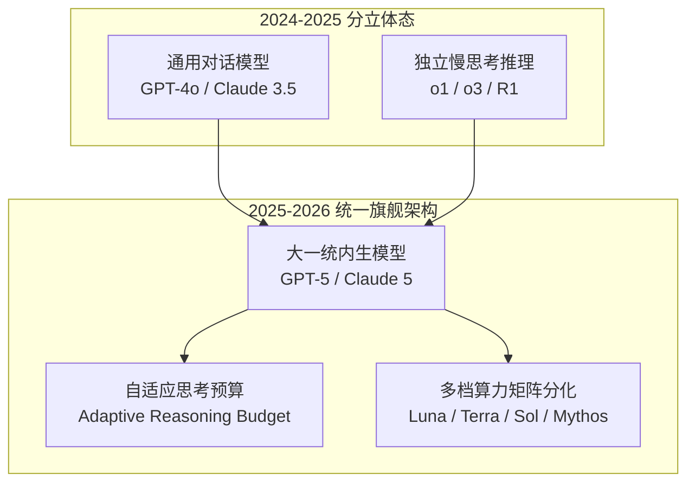

# 第九章：前沿裂变与范式重构 (2025 - 2026) —— 通用旗舰大一统、Meta 闭源转向、System 1 决策模型 Jev 与物理/具身生态

> **核心主题**：GPT-5/6 与 Claude 5/Mythos 旗舰演进、Meta 前沿线转向闭源（Muse Spark，内部代号 Avocado）、开源权重许可分化、System 1 决策模型（Jev 开创的“智能 if 语句”与生态克隆潮）、领域特化模型、具身智能与世界模型分流、编码 Agent Harness 层。

---

## 1. 前沿闭源通用大模型演进：旗舰大一统与代际洗牌 (2025 - 2026)

进入 2025 至 2026 年，顶级商业实验室逐渐告别了早期“一个聊天模型、一个推理模型、一个多模态模型”的碎片化组合，走向了**推理与对话无缝内生统一、自适应多档位算力分配**的旗舰大一统形态。



### 1.1 OpenAI：从外挂推理走向内生大一统与阶梯家族

- **GPT-4.1 (2025.04)**：
  - 聚焦专业长程编码与百万 Token（1M context）无损上下文，作为 GPT-4 时代的终极工程优化版。
- **o3 / o4-mini (2025.04)**：
  - 推理模型独立演进分支，进一步降低思考延迟并提升数学、物理与安全攻防推理基准。
- **GPT-5 (2025.08) —— 划时代大一统**：
  - **核心范式转变**：正式将“快思考（直觉生成）”与“慢思考（链式强化推理）”在底层神经网络中融为一体，取代了原先 GPT-4o 与 o3 的二元分立，成为 OpenAI 默认统一基座；
  - 模型根据用户指令的隐式复杂度，全自动判定是否触发思考、动态分配思考 Token 长度。
- **GPT-5.6 家族 (2026.07) —— Luna / Terra / Sol 三档矩阵**：
  - **Luna**：轻量高频档，针对低延迟日常会话与简单任务；
  - **Terra**：主力均衡档，兼顾深度代码构建与复杂知识分析；
  - **Sol**：顶级超算档，专供科学定理证明、跨学科突破与复杂多智能体编排。
- **GPT-6 / GPT-6.1 / GPT-6.2 (2026.09 - 11)**：
  - 延续 Astra / Terra / Sol 架构分层；**GPT-6.2 Astra & Sol（2026.11.17）** 引入 105 万上下文，显著提升法律/金融/会计模板遵循度与输出 Token 效率，刷新 Terminal-Bench-Science 与 ARC-AGI-2 记录；**GPT Image 2.6（Flare / Sunburst，2026.11.04）** 实现 SVG 矢量导出、GIF 动图与涂鸦局部编辑。

### 1.2 Anthropic：编码统治力、自适应思考与 Claude 5 体系

- **Claude 4 Opus / Sonnet (2025.05)**：
  - 确立“全球最佳编码模型”行业共识的起点，SWE-bench Verified 基准再次大幅刷新纪录。
- **Claude Sonnet 4.5 / Opus 4.5 (2025.09 - 11)**：
  - 巩固长程复杂软件工程与跨文件重构能力。
- **Claude 5 代际 (2026.06 - 09) —— 分层矩阵与自适应思考**：
  - **Fable 5 / Mythos 5（2026-06-09）**：Fable 5 面向公众；Mythos 5 通过 Project Glasswing 仅向受信任机构开放网络安全能力；
  - **Opus 5（2026-07-24）**：补齐常规 Opus 档位，主打长程软件工程与智能体任务；
  - 引入**自适应思考机制（Adaptive Thinking）**，支持调节思考预算与 Token 消耗上限。
- **Claude 5.x 细化矩阵 (2026 下半年)**：
  - **Opus 4.7（2026.04）/ Opus 4.8（2026.05）**：Claude 5 前夕的 4.x 收官迭代，正式开启 1M 上下文并强化 ASL-3 长程自主执行；
  - **Opus 5.5 / Sonnet 5.5（2026.09）/ Haiku 5.5（2026.10）**：覆盖端侧极速响应到重载 Agentic 决策；
  - **Fable 5.2 / Mythos 5.2（2026.11.09）**：Fable 5.2 面向公众并内置高风险域降级，Mythos 5.2 继续走受限访问；**Claude Ship & Claude Design（2026.11.23–24）** 进一步将代码审查与原型生成纳入自动化协同流水线。

### 1.3 Google DeepMind：Gemini 3/4 与全模态流式交互

- **Gemini 3 Pro / 3.x Flash (2026 上半年)**：
  - 在自研 TPU 算力集群上实现能耗比与推理吞吐的阶跃。
- **Gemini 4 化学元素矩阵 (2026.09 - 11) —— Argon / Carbon / Hydrogen / Neon 四档体系**：
  - Google DeepMind 在 Gemini 4 代放弃了传统的数字小版本递增命名，转而以化学元素命名，构建了覆盖能力、速度与成本帕累托前沿的四档分级矩阵：
    - **Gemini 4 Argon（2026-09-30）**：面向深度专业与科研场景的高阶长程推理基座；
    - **Gemini 4 Carbon（2026-11-10 官方 Model Card）**：重型高算力旗舰，专攻最困难的多步骤长程推演与跨领域验证；
    - **Gemini 4 Hydrogen（2026-11-12 官方 Model Card）**：极致轻量与超低延迟模型，首创毫秒级原生流式多模态，服务于高并发 API 与边缘端侧；
    - **Gemini 4 Neon（2026-11-18）**：前沿代码与高阶分析智能体，介于 Carbon 与 Hydrogen 之间。具备 1M 上下文，支持 Low / Medium / High / XHigh 四档自适应动态思考（Adaptive Thinking），原生深度集成入 Google Antigravity、Gemini API 与企业开发套件。
- **Gemini Omni & Gemini Omni 1.2 Flash (2026.05 - 11)**：
  - 任意模态输入生成视频的原生全模态模型；**Gemini Omni 1.2 Flash（2026.11.05 正式 GA）** 支持最长 15 秒 4K 原生配音视频生成、对话式多轮局部编辑与跨镜头主体一致性，API 单价直降 30%。

### 1.4 Meta 的路线大转向：从开源领袖到 Muse Spark 闭源商业化

长期以来，Meta 被公认为全球开放权重生态的最强灯塔。然而在 2025 至 2026 年，这一战略格局发生了震惊业界的剧烈震荡：

```
                      Meta 大模型战略路线的历史性分叉

  2023 - 2024 (开放权重鼎盛期)             2025 - 2026 (商业闭环与路线分道)
─────────────────────────────────────────────────────────────────────────────
  LLaMA 1 (7B-65B) 开源平权                 Llama 4 Scout / Maverick (2025-2026 开放主力)
  LLaMA 2 (GQA商用化)                                       │
  LLaMA 3 / 3.1 (405B 万卡超算开源)                          ▼
                                     ★ 2026 重大转折: Muse Spark（代号 Avocado）★
                                     (Llama 5 继任者转向闭源商业线，开放权重线收缩)
```

1. **Llama 4 Scout / Maverick (2025 - 2026)**：
   - 维持开放权重传统，作为开源社区抵抗商业闭源大厂的顶梁柱；
2. **路线转向：Muse Spark / Wonder / Ember (2026.04 - 11)**：
   - 作为 Llama 5 原定继任项目，Meta 核心层基于算力摊销、资本回报率（ROI）与前沿对齐安全的综合考量，**把旗舰线转向闭源专有商业化 API**。代号 Avocado 在 2025-12 至 2026-03 的媒体报道中广泛出现，最终以 **Muse Spark** 之名发布；后续扩展出 **Muse Wonder**（重载推演）与 **Muse Ember（2026.11.09）**（$0.10/$0.50 per 1M tokens 的极低成本子智能体高频执行层）；
   - 同时保留了由 Superintelligence Labs 开源的端侧 **Muse Glimmer（30B, Apache 2.0）** 作为端侧开源探索分支。

### 1.5 xAI、阿里通义与月之暗面 (2026 年底最新迭代)

- **xAI Grok 4.5 / 4.6（2026.07 - 08）**：
  - 基于孟菲斯持续扩容的超算中心，提供 `low / medium / high / xhigh` 四档显式推理计算开关，在终端 Agentic 自动化操作（CLI / OS 自动化执行）上具备极强统治力。
- **阿里巴巴 Qwen4-Max（2026.11.16）**：
  - 通义千问第四代闭源旗舰，采用 2.4T 稀疏 MoE 骨干 + 328B N-gram 嵌入架构，单步激活仅 71B（较 Qwen3.8-Max 减少约 25%），支持 1M 全模态上下文与默认思考模式，企业长任务成本大幅下降 60%。
- **智谱 GLM-5.4（2026.11.23）**：
  - 引入全新权重共享循环迭代架构（**Loop Transformer**），以约 750B 实体参数基座实现媲美 2T–3T 模型的通用编程与深度推理，与同期开源的 Inkling 2 Mini 共同引爆循环深度计算浪潮。
- **月之暗面 Kimi K3 / K3.1 Pro（2026.07 - 11）**：
  - 总参数达 **2.8 万亿（2.8T MoE）**，**Kimi K3.1 Pro** 于 2026 年 11 月 4–5 日在 Hugging Face 全量开源权重，兼顾超长文本记忆、原生多模态 Agent 规划与 vLLM/Inferact Day-Zero 生产级推理。
- **腾讯混元 Hy4 / Hy4 Flash & 百度 ERNIE 5.5 Flash（2026.11）**：
  - 腾讯混元 Hy4 于 11 月 20 日全量开源，Hy4 Flash（224B-A12B MoE）支持原生视觉与桌面操控；百度发布 280B 稀疏 MoE 开放权重 **ERNIE 5.5 Flash**，聚焦编码、3D 设计与百万上下文智能体。

---

## 2. 开源权重与开源许可证谱系矩阵 (2025 - 2026)

在 Meta 战略分化的背景下，2026 年的开源大模型呈现出“**中国主力全面挑大梁、许可证精细化分层、轻量端侧全面繁荣**”的新特征：

```mermaid
graph LR
    subgraph 宽松自由开源 (Permissive Apache 2.0 / MIT)
        DeepSeek[DeepSeek V4.1-Flash / V4 Pro<br/>MIT 协议 / 极限性价比]
        Qwen27B[Qwen3.8-27B<br/>Apache 2.0 / 27B 原生多模态]
        Gemma4[Gemma 4 31B<br/>Apache 2.0 / 内置 Thinking Mode]
        MuseGlimmer[Muse Glimmer 30B<br/>Apache 2.0 / 端侧 Agentic 多模态]
        Inkling[Inkling 2 Mini<br/>Apache 2.0 / 循环 Transformer]
        GLMFlash[GLM-5.3-Flash<br/>MIT 协议 / 端侧极速]
    end

    subgraph 商业化保护 / 专有开放权重
        GLM53[GLM-5.3<br/>自定义商业限制许可]
        Llama4[Llama 4 Scout/Maverick<br/>月活超额需商业授权]
        Nemotron[Nemotron 3.5 Super VL<br/>NVIDIA 开放权重 / 120B MoE]
        MiniMaxM3[MiniMax M3 / M3.1<br/>428B MoE 专属许可]
    end
```

### 2.1 2026 年主流开源家族与代表版本全景

| 家族 / 机构 | 2026 代表版本 | 许可证类型 | 核心技术特征与历史生态定位 |
| :--- | :--- | :--- | :--- |
| **DeepSeek (深度求索)** | **V4.1-Flash / V4 Pro** | **MIT 许可证** (完全自由) | 继 R1 引爆推理浪潮后，在低显存推理与超高性价比 Agent 编码领域持续作为全球开源标杆 |
| **Qwen (阿里通义)** | **Qwen3.8-27B / Qwen3.8-MoE** | **Apache 2.0** (27B) / 专属开源 | 27B 稠密版以 Apache 2.0 开源，具备原生高保真视觉感知与代码智能体能力，单卡易部署 |
| **Gemma (Google)** | **Gemma 4 31B / E4B / 12B** | **Apache 2.0** (全面宽松开源) | 31B 稠密基座源自 Gemini 3 技术底座，内置思考模式与函数调用，支持 140+ 语言与单卡部署 |
| **Meta 开源分支** | **Muse Glimmer (30B)** | **Apache 2.0** (端侧开源专精) | 在主干转向闭源后，由 Superintelligence Labs 开源的 30B 端侧 Agentic 模型，原生适配 MCP |
| **Thinking Machines** | **Inkling 2 Mini (26.4B)** | **Apache 2.0** (完全自由) | 首创 Looped Transformer（中间 12 层循环 3 次，等效 48 层），32GB Mac 上极高性价比多模态 Agent |
| **NVIDIA** | **Nemotron 3.5 Super VL** | 开放模型许可 (Open Model) | 120B MoE（激活 12B），单 GPU 吞吐提升 5 倍，专攻长达数周的长周期软件工程与科研 Agent 任务 |
| **GLM (智谱 AI)** | **GLM-5.3-Flash / GLM-5.3** | Flash 为 **MIT**；大尺寸为自定义商业许可 | 清华工程传承，Flash 版成为端侧与学术首选，大尺寸版兼顾企业级商业化定制 |
| **MiniMax (稀宇科技)** | **M3 / M3.1-Flash** | 开放权重商业许可 | 总参数约 428B、单步激活 23B 的多模态 MoE，专长于 Agent 自主规划与网络安全分析 |
| **Mistral AI** | **Mistral Large 3 / Small 4** | Apache 2.0 / 商业双轨 | 欧洲人工智能代表，主打欧洲数据主权（Data Residency）与企业合规治理 |
| **OpenAI gpt-oss** | **gpt-oss-20b / 120b** | 开放权重许可 (2025.08 启动) | OpenAI 迫于开源生态压力，通过 Ollama 等渠道开放的部分蒸馏权重 |
| **Kimi (月之暗面)** | **Kimi K3 (开源探索版)** | 社区许可 | 2.8T MoE 超大基座的探索性权重释放，主打长期记忆与复杂多模态推理 |

> **关键认知：区分“开源权重”与“完整开源”**
> 2026 年社区对 License 的辨析愈发严谨：以 DeepSeek（MIT）、Qwen3.8-27B（Apache 2.0）、Gemma 4 31B（Apache 2.0）、Muse Glimmer（Apache 2.0）与 Inkling 2 Mini（Apache 2.0）为代表的宽松许可允许无条件商业化与自由闭源再分发；而 Llama 4、GLM-5.3 则包含月活用户阈值或场景限制条款；Meta Avocado 的主干闭源转向更促使全球开发者将供应链安全建立在更纯粹的宽松开源基座上。

---

## 3. 范式级突围：System 1 纯决策模型（Jev 开创的“智能 if 语句”革命）

在 2026 年的大模型技术演进史中，最具备破坏性创新的范式事件并非单纯的“参数扩大”，而是以 **Jev** 为代表的 **“System 1 决策模型（Decision Models）”** 的横空出世。

```
                  两类根本性范式的认知与计算解耦

  维度                 经典自回归 LLM (如 GPT-5 / Claude 5)          System 1 决策特化模型 (如 Jev)
─────────────────────────────────────────────────────────────────────────────────────────────
 核心使命             自由文本续写、逻辑阐述、多轮对话、长篇生成        从海量非结构化状态中抽取确定的结构化离散动作
 输出形式             高变异度非结构化自然语言 (Tokens / Strings)     严格强类型结构 (Typed Decision / Calibrated Probabilities)
 计算耗时             2 秒至数十秒 (慢思考 / 自回归多步串行)          70 毫秒至 500 毫秒 (非自回归单步快速推导)
 确定性与风险         格式容易破坏、存在胡言乱语 (Hallucination)      数学严格校准置信度、零文本冗余、零语法污染
 经典角色定位         人类参谋、论文作者、代码生成专家                代码流水线中的“智能 if 语句”、高频流量调度网关
```

### 3.1 Jev (TypeSafe AI, 2026.09.15)：System 1 决策模型的命名者与破局点

2026 年 9 月 15 日，TypeSafe AI 正式发布 **Jev**：
- **不生成任何自然语言文本**：输入包含多模态上下文、用户操作历史或网络抓取状态的非结构化 Payload；
- **输出强类型决策矩阵**：直接输出带有精准贝叶斯校准概率（Calibrated Probabilities）的枚举项（Enum）、布尔路由信号或结构化评分；
- **极速响应与确定性**：单次推理延迟稳定在 **70ms - 500ms**，可直接无缝嵌入高并发交易系统、智能路由网关、内容风控防火墙或自动化控制流水线；
- **行业震动**：开发者第一次意识到，过去用臃肿的 70B/400B 巨模来做“判断用户是否意图退款”、“挑选调用哪个 API 工具”这类决策，是严重的算力浪费与架构错位。Jev 开创了“**用 System 1 决策特化模型彻底接管系统逻辑分支**”的全新时代。

### 3.2 生态接力：可核实的开源对应物

Jev 之后，"决策模型"迅速成为一个独立品类。可以核实的部分是：开源社区在一周内出现了克隆项目
（其中 Databricks 的 open-Jev 有媒体报道），vLLM 语义路由项目也发布了面向同一场景的
Decision 3.0 系列。但流传较广的若干轻量型号名——`Laya`、`DiffusionGemmaJev`、
`Bespoke Nimble`、`SemIf`、`THX-01`、`One Gemma`——在公开检索与本地 Wikipedia 语料中
均未找到痕迹，本仓库暂不收录，列此待证（欢迎补充一手来源后恢复）。

1. **开源对应物：Decision 3.0 系列（vLLM Semantic Router，2026.10）**：
   - 覆盖 d3 / d3-flash / d3-mini 等尺寸，权重开源于 Hugging Face；
   - 定位与 Jev 一致：把"该调哪个工具 / 该走哪个分支"从通用 LLM 中剥离，交给更小、更确定、更低延迟的模型完成。
2. **设计取向收敛**：非自回归单步输出、强类型枚举、校准置信度——这三条正在成为"决策模型"的事实标准。

### 3.3 双系统演进大闭环：从慢思考到快决断

至此，大模型在 2024-2026 年完成了对卡尼曼“双系统认知理论”的完整工程映射：
- **System 2 慢思考**：从 2024 年 o1、2025 年 DeepSeek-R1，演进至 2026 年被深度嵌回 GPT-5 与 Claude 5 的原生自适应推理逻辑；
- **System 1 快决策**：从 Jev 到 Decision 3.0，演化为工业智能体体系中高频、确定、低延迟的骨干调度神经元。

---

## 4. 垂直与领域特化模型（Domain-Specific AI）

通用基座大一统的同时，生物医药、数学工程与垂直工业领域涌现了一批依靠**专属表征与领域物理定律硬约束**构建的非通用重器：

### 4.1 蛋白质、DNA 与生命科学计算

<!-- 2026-11-14 注：VenusPLM / VenusPod 在公开检索与本地语料中均无痕迹，暂不入库，待补一手来源。 -->
- **ESM2 (Meta) 与 EVO2 (Arc Institute)**：
  - Meta ESM2 作为 650M 掩码蛋白质语言模型依然是全球结构生物学任务的基础特征提取经典基线；
  - Arc Institute 的 **Evo2 (evo2_40b)** 拥有 400 亿参数，专攻长基因组跨尺度变异与 DNA 序列生成。
- **NVIDIA 生命科学套件与统一生成模型**：
  - **ProteinMPNN** 与 **Proteina-Complexa 160M (2026.03)**：专攻复杂抗原-抗体复合体结合设计与纳米抗体定向进化；
  - NVIDIA NIM 统一生成架构将酶工程、配体设计与结合能打分整合入模块化工业流程。

### 4.2 医疗、金融与细分设计小特化

- **医疗特化**：以 **Meditron** 等为代表，结合循证医学指南与真实临床病历开展多阶段对齐微调；
- **金融特化**：**FinGPT** 持续深耕量化时序情感抽取、金融图谱推理与多因子投资逻辑审计；
- **小特化潮流（Small Specialized Models）**：
  - **VibeThinker (WeiboAI)** 与 **AesCoder**（利用 GRPO 强化学习针对 Web 界面视觉美感与前端工程代码开展专项优化），代表了 2025-2026 年利用后训练技术打造“小而美、领域天花板”的鲜明技术流派。

---

## 5. 具身智能 (Embodied AI) 与世界模型 (World Models) 的分流大图景

在 2026 年，过去常常被混为一谈的“世界模型”与“具身智能”彻底完成了**叙事与技术分工的清晰解耦**：

```
       世界模型 (World Models)                       具身智能 (Embodied AI)
 ┌─────────────────────────────────┐           ┌─────────────────────────────────┐
 │ 核心任务: 物理规律仿真与空间因果预测 │           │ 核心任务: 多模态感知与实体动作闭环控制│
 │ 关注点: "如果球滚落，世界如何变化?"  │           │ 关注点: "机械手该以何种力道抓起杯子?" │
 │ 技术路线: 视频 Token 扩散 / 3D 高斯 │           │ 技术路线: VLA 架构 / 流匹配 / 强化学习│
 │ 典型代表: Genie 3 / Cosmos / GWM │           │ 典型代表: GR00T / π₀ / Helix / GO-2  │
 └─────────────────────────────────┘           └─────────────────────────────────┘
```

### 5.1 具身智能基础模型：从视觉语言到动作（VLA）与流匹配（Flow Matching）

- **Google DeepMind: Gemini Robotics ER 2 (2026.07)**：
  - 具身推理升级：实时视频理解、任务进度跟踪、低延迟编排（Gemini Live API）与多机器人协作，首次通过 API 向开发者开放。
- **NVIDIA: GR00T N1 (2025.03)**：
  - 依托 Isaac Sim 物理仿真平台与数万台人形机器人实时遥操作数据预训练，成为全球机器人厂商通用大脑的标杆平台。
- **Physical Intelligence (π): π₀ / π₀.₅ / π₀-FAST / π0.7**：
  - 彻底抛弃低频的离散动作 Token 化，采用**流匹配（Flow Matching）连续动态扩散机制**，实现了机器人机械手的高频（50Hz+）丝滑控制，在折衣服、洗碗、装箱等非结构化家政场景展现出惊人泛化力。
- **Figure AI Helix & Skild AI Skild Brain & 1X Redwood**：
  - 推动工业人形机器人进入汽车总装流水线与精密仓储。
- **中国具身智能先锋矩阵**：
  - 智元 **GO-2**、自变量 **WALL-A**、智平方 **GOVLA**、星海图 **G0 Plus / Fast-WAM** 构成中国具身机器人算法与本体协同的第一梯队。

### 5.2 世界模型：从生成像素走向可交互物理引擎

- **Google DeepMind Genie 3 (2026)**：
  - 参数超 110 亿，输入单张概念设计草图即可实时动态生成**完全可被键盘操控游玩的 3D 交互世界帧序列**，隐式掌握了碰撞体积与重力加速度法则。
- **NVIDIA Cosmos / Cosmos 3 (2026)**：
  - 采用 **MoT (Mixture of Trainers)** 架构的全模态物理 AI，支持工业级数字孪生工厂与自动驾驶极端 Corner Case 的精准动力学演化推演。
- **Runway GWM-1 Worlds & 腾讯 HY-World 2.0**：
  - 支持无限镜头漫游的沉浸式 3D Rollout；腾讯开源首个高保真 3D 世界模型。
- **阿里三界世界模型与李飞飞 World Labs**：
  - 阿里布局 **Qwen-AgentWorld（语言逻辑世界）/ HappyOyster（虚拟沙盒世界）/ Qwen-RobotWorld（实体物理世界）**；
  - 李飞飞创办的 **World Labs (Marble)** 引入原生 3D 高斯泼溅（3DGS），将单目图像实时重建为支持任意视角的物理空间；Stanford/NVIDIA **PointWorld** 探索 3D 点云连续流建模。

---

## 6. 生成式媒体与文生视频矩阵 (2025 - 2026)

- **OpenAI Sora 2 (2025 - 2026)**：
  - 实现最高 60 秒、1080p 分辨率的多镜头连续叙事，并且实现了**原生环境音效与台词唇形音频端到端同步生成**。
- **专业影视与消费社交阵营**：
  - **Runway Gen-4.5 / Aleph**：专攻分镜一致性与专业影视级精准局部重绘（Inpainting）；
  - **Pika 2.5**：主打 5 秒极速渲染与病毒式社交特效；
  - **中国视频模型梯队**：快手 **可灵 (Kling 3.0)**、MiniMax **海螺 (Hailuo 02)**、阿里 **万相 (Wan 2.7)** 与字节跳动 **即梦 AI** 在运镜控制、物理刚体运动与人物面部真实度上在全球消费市场稳居领先席位；
  - **Google Veo 3.1 & Gemini Omni**：融合 YouTube 高清多模态语料，推动多模态实时交互创作。

---

## 7. 编码 Agent 与工具层（Harness 决定模型终极效能）

在 2026 年，软件工程基准（如 SWE-bench Multimodal、RepoEval）的竞争已不仅取决于模型参数权重，更取决于包裹在模型外部的**执行架构与测试沙盒（Harness Layer）**：

```
                    现代编码智能体 (Coding Agent) 架构栈

   ┌─────────────────────────────────────────────────────────────┐
   │            人机交互界面 / 编辑器中枢 (UI Interface)         │
   │  Claude Code / Cursor / GitHub Copilot / OpenCode / Devin   │
   └──────────────────────────────┬──────────────────────────────┘
                                  ▼
   ┌─────────────────────────────────────────────────────────────┐
   │         测试与调度框架层 (Agent Harness & Orchestration)     │
   │  - 动态检索切片 (Repo Indexing)   - 自动化终端命令重试与回溯 │
   │  - 测试用例自动生成与验证 (Self-Test) - Linting / 编译反馈闭环│
   └──────────────────────────────┬──────────────────────────────┘
                                  ▼
   ┌─────────────────────────────────────────────────────────────┐
   │             核心模型大脑 (Model Intelligence)               │
   │  Claude 5 Sonnet / GPT-5.3-Codex / Qwen3-Coder / DeepSeek-V4│
   └─────────────────────────────────────────────────────────────┘
```

1. **核心认知：同一模型在不同 Harness 下能力断代**：
   - 评测证实：同一个底层模型（如 Claude 4.5 Sonnet），在缺乏工具回溯反馈的裸调用模式下 SWE-bench 得分可能仅为 35%；而在配备了语义代码图索引、测试用例自编译与动态错误回溯机制的高级 Harness（如 Claude Code 或 Cursor Cloud Agent）协同下，基准得分可跃升至 **70% 以上**。
2. **主要生态代表**：
   - **Anthropic Claude Code**：紧密结合终端 Bash 环境与 MCP 协议的官方自主编码代理；
   - **OpenAI Codex CLI / Cloud** 与 **GitHub Copilot CLI / Cloud Agent**；
   - **全自动软件工程师产品**：Cursor / Cursor Cloud Agent、Devin、Jules；
   - **开源智能体框架**：OpenCode、OpenHands、Cline。

---

> 📚 本章引用与一手来源见 [references.md](references.md)；数据字段规范见 [schema.md](../data/schema.md)。
