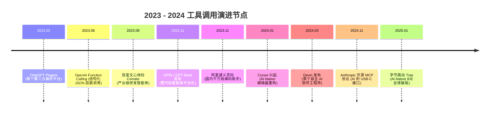

# 第十章：智能体、MCP 与工具生态演进史 (2021 - 2026) —— 从代码补全到自主智能体、统一连接协议与工程平台

> **核心主题**：智能体（Agent）范式革命、OpenAI Codex 与 GitHub Copilot、中国代码助手先锋（CodeGeeX / 通义灵码 / 文心快码）、Devin 与 AI-First IDE（Cursor / Trae）、Model Context Protocol (MCP) 标准大一统、终端原生智能体 Claude Code、Google Antigravity 全栈智能体工程平台、沙箱安全治理与未来协作范式。

---

## 1. 范式跨越：为什么“大模型 + 工具”是通向 AGI 的必经之路？

纯粹的大语言模型（LLM）即便参数规模达到千亿乃至万亿，本质上依然是一个被禁锢在**静态权重空间**里的概率计算器：
1. **无法获取实时动态信息**：受制于知识截止日期（Knowledge Cutoff），模型无法感知当下的生产环境告警、最新 API 文档或代码库动态变更；
2. **缺乏确定性计算能力**：自回归预测下一个词在进行多位数长除法或复杂矩阵运算时极易出现微小浮点误差，而传统计算机计算器可以在 1 微秒内给出严格精确的结果；
3. **缺乏改变环境的执行手脚**：模型输出的只是文本字符，无法自主修改本地工程文件、执行编译测试套件、部署云服务器或向第三方 API 发起写入。

从“语言模型（Passive Oracle）”走向“自主行动智能体（Autonomous Agent）”，核心在于赋予模型**感知（Perception）、规划（Planning）、记忆（Memory）与工具执行（Tool Use）**的四位一体能力。

```
                     自主智能体 (Autonomous Agent) 核心架构

   ┌─────────────────────────────────────────────────────────────┐
   │                      用户自然语言意图                        │
   └──────────────────────────────┬──────────────────────────────┘
                                  ▼
   ┌─────────────────────────────────────────────────────────────┐
   │                  规划与决策中枢 (Brain / LLM)                │
   │  - 目标拆解 (Decomposition)        - 自我反思纠错 (Reflection)│
   │  - 短期上下文 / 长期向量记忆 (Memory)                         │
   └──────────────────────────────┬──────────────────────────────┘
                                  ▼
   ┌─────────────────────────────────────────────────────────────┐
   │            通用工具与协议连接层 (Execution & MCP)            │
   ├──────────────┬──────────────┬──────────────┬────────────────┤
   │ 终端与代码   │ 浏览器 GUI   │ 外部 API 集合 │ 数据库与检索   │
   │ (Bash/Python)│(Computer Use)│(SaaS / REST) │ (Vector / SQL) │
   └──────────────┴──────────────┴──────────────┴────────────────┘
```

---

## 2. 早期萌芽与代码生成助理 (2021 - 2022)

### 2.1 OpenAI Codex 与 GitHub Copilot (2021)
2021 年是代码大模型与智能辅助编程的元年：
- **OpenAI Codex (2021.07)**：
  - OpenAI 发表开创性论文 *Evaluating Large Language Models Trained on Code*，发布基于 GPT-3 在 GitHub 海量公开开源代码库上微调得到的专用代码生成模型 **Codex (12B)**；
  - **HumanEval 基准**：提出由 164 个手工编写带有单元测试的 Python 编程问题组成的测试集，确立了全球评估代码生成质量的黄金标准（pass@k 指标）；
  - **Fill-in-the-Middle (FIM)**：突破了自回归模型只能从前向后单向续写的限制，支持结合光标前缀（Prefix）与后缀（Suffix）推断中间缺失代码。
- **GitHub Copilot (2021.06 技术预览, 2022.06 正式商用)**：
  - GitHub、微软与 OpenAI 联手打造的首个消费级 AI 结对编程助手（Pair Programmer），以轻量级插件形式无缝嵌入 VS Code 与 JetBrains IDE；
  - **历史意义**：这是生成式 AI 首次真正深入全球数百万人类工程师的日常生产力链路，证明了“补全上下文 $\to$ 预测代码块”的巨大商业价值，拉开了现代代码智能体的帷幕。

### 2.2 中国代码大模型开源先锋：清华与智谱 CodeGeeX (2022.09)
在中国大模型生态早期，代码领域往往被视为技术壁垒最高的赛道之一：
- **CodeGeeX (2022.09)**：由清华大学 KEG 实验室与智谱 AI 联合研发并完全开源的 130 亿参数（13B）多语言代码大模型；
- **技术突破**：在单台国产算力与 NVIDIA 服务器上高效训练，支持 Python、C++、Java、JavaScript、Go 等 20 多种编程语言；
- **跨语言代码互译**：首创在 IDE 插件中实现跨语言代码语义等价转换（如将 C++ 自动化迁移为 Python/Go），并完全开放模型权重与 VS Code / JetBrains 插件生态，成为国内代码大模型技术与生态的开山之作。

---

## 3. 工具调用探索与中国产业级助手落地 (2023)

ChatGPT 引爆全球后，大模型连接外部数字世界的架构探索进入白热化阶段：



### 3.1 ChatGPT Plugins (2023.03) 的热潮与退场反思
- 2023 年 3 月，OpenAI 推出 ChatGPT Plugins，首次接入 Expedia、Wolfram Alpha、KAYAK 等 70 多个第三方外部服务；
- **经验教训**：早期插件依赖复杂的 API 规范解析与网络轮询，用户体验极易卡顿、多插件协作时路由混乱，最终在 2024 年初被 OpenAI 正式关停，为后续更加标准化的工具协议提供了前车之鉴。

### 3.2 函数调用标杆：Function Calling (2023.06)
- OpenAI 在 GPT-3.5/4 系列中原生支持 **Function Calling**：允许开发者提供 JSON Schema 格式的函数签名定义，模型自发判断是否需要调用、并严格按照 Schema 输出类型安全的参数 JSON。这成为所有现代 Agent 系统的底层调用基础。

### 3.3 GPTs 与平台化浪潮 (2023.11)
- OpenAI 推出 GPTs 与 GPT Store，允许普通用户无需编写任何代码，通过自然语言对话配置指令（System Prompt）、挂载私有知识库（RAG）和绑定 Actions API，构建专属自定义智能体。

### 3.4 中国产业级智能研发助手规模化爆发 (2023 - 2024)
面对中国庞大的工程师群体与复杂严苛的企业内部研发环境，国内科技巨头迅速展开了产业级代码助手布局：
- **阿里巴巴 通义灵码 (TONGYI Lingma, 2023.11)**：
  - 基于阿里云通义大模型（Qwen-Coder 前沿底座）打造，成为国内首个突破千万级下载量的 AI 编程助手；
  - **核心特性**：深度适配企业级私有代码库，首创毫秒级代码检索与工程上下文 RAG，支持代码续写、单元测试批量生成、代码解释与多步排错，在金融、互联网和制造业企业中占据国内市场首位；
- **百度 文心快码 (Baidu Comate, 2023.06)**：
  - 依托百度飞桨平台与文心一言基座打造的产业级研发智能体；
  - **核心特性**：覆盖研发全生命周期（需求理解、代码生成、单测编写、代码审查 Code Review、技术问答与系统重构），深度融入百度内部超 80% 的日常研发流水线，并在金融、央国企及运营商私有化部署中居于领先；
- **腾讯云 AI 代码助手 (2024.04)**：
  - 基于腾讯混元大模型打造，深度融入微信小程序开发者工具（WeChat DevTools）与腾讯云 Cloud Studio，实现从小程序前端到云端全栈代码的无缝辅助。

---

## 4. 自主软件工程师与 AI-Native IDE 革命 (2024)

2024 年，智能体从“单步提示词补全”迈向了“长程跨文件自主规划与环境执行”。

### 4.1 Devin 的震撼登场 (Cognition AI, 2024.03)
- 由 Scott Wu 创立的 Cognition AI 发布了全球首个**自主 AI 软件工程师 Devin**；
- 配备完整的沙箱运行环境（内置终端、代码编辑器和浏览器）；
- 在真实 GitHub 开源问题基准 **SWE-bench** 上斩获 13.86% 的无辅助解决率（当时行业顶尖水平仅约 1.96%），向世界展示了智能体自主调试错误、运行测试用例、自动修复 Bug 的未来范式。

### 4.2 AI-First IDE 标杆：Cursor 与 Windsurf
- **Cursor (Anysphere)**：重构了传统 VS Code 的交互形式，推出 `Composer`、多文件跨工程同时编辑、全局代码库语义索引以及终端自动纠错，成为硅谷与全球开发者几乎人手必备的生产力神器；
- **Windsurf (Codeium, 2024.11)**：提出“Cascade（瀑布式）Flow”协同人机交互，将人类思考意图与智能体自主探测融合为沉浸式流式编程。

### 4.3 字节跳动 Trae 与 扣子 (Coze)：中国 AI-Native IDE 的全球破局 (2024 - 2025)
- **Trae (ByteDance, 2025.01)**：
  - 字节跳动推出的全新自研 AI-Native 集成开发环境（IDE），直接面向全球开发者发布，打破了 Cursor 在 AI IDE 领域的长期垄断；
  - **Builder 模式与 Agent 进化**：不仅支持 Chat 交互，更推出了革命性的 **Builder 模式**——用户只需用自然语言提出产品需求，Trae 能够自主分析项目结构、跨文件创建与修改代码、在内置终端中自动安装依赖并执行编译命令，并配备**实时 Web 视图预览（Web Preview）**；
  - **自适应智能路由**：根据任务复杂度智能动态调度顶尖基座模型（Claude 3.5 Sonnet、GPT-4o 或豆包模型），实现最佳编码效果与极低延迟；
- **扣子 / Coze (ByteDance, 2024.02)**：
  - 字节跳动推出的无代码/低代码 AI Agent 编排平台，支持多智能体协作流（Multi-Agent Flow）、插件市场与长期记忆管理，可一键发布至飞书、微信公众号、抖音等平台，极大降低了全民构建复杂工作流智能体的门槛。

---

## 5. 时代定义性标准：MCP (Model Context Protocol) 诞生 (2024.11)

在大模型与成千上万外部数据源（GitHub、Slack、PostgreSQL、本地文件、终端工具）连接的过程中，每个开发者都不得不为不同的模型和工具编写定制适配胶水代码，造成严重的“N×M 碎片化孤岛危机”。

```
                    传统 N×M 碎片化连接 vs 统一 MCP 标准

    传统架构 (碎片化维护)                     MCP 标准架构 (开放互联)

   模型 A ──┬── 工具 1 (GitHub)               模型 A ──┐
   模型 B ──┼── 工具 2 (PostgreSQL)            模型 B ──┼──► [ MCP 统一协议中枢 ]
   模型 C ──┴── 工具 3 (Slack)                 模型 C ──┘              │
   (每个模型需要维护专属驱动代码)                                       ▼
                                                       ┌───────┬───────┬───────┐
                                                       │GitHub │ Postgres Slack│
                                                       └───────┴───────┴───────┘
```

### 5.1 什么是 MCP？
2024 年 11 月 25 日，Anthropic 正式开源并宣布推出 **Model Context Protocol (MCP)**：
- **定义**：MCP 被誉为 **“AI 时代的通用 USB-C 接口”**，是一套开放标准协议，用于安全、可审计地向前沿模型暴露本地文件、数据库查询、开发工具和云端 SaaS 接口；
- **三大核心抽象**：
  1. **Resources（只读资源）**：向模型提供上下文文件、日志、数据库表结构等静态数据流；
  2. **Prompts（可复用提示词模版）**：由服务端预先封装的最佳实践交互指令；
  3. **Tools（可执行工具）**：可供模型主动调用并产生实际副作用的确定性功能（如发起 Git Commit、执行 SQL 写入）。
- **行业生态狂潮**：发布后数月内，Block、Apollo、Docker、Zed、Cursor、AWS 以及全网数十万开源开发者迅速加入支持，2025 年底转入行业中立的 Agentic AI Foundation 基金会维护，成为全球智能体连接的绝对事实标准。

---

## 6. 终端原生与全栈工程平台大决战 (2025 - 2026)

进入 2025–2026 年，智能体形态迎来了更高阶的分化：从“图形界面的编辑器插件”走向了**“极简高带宽的终端智能体（CLI Agent）”**与**“分布式多智能体工程平台（Agentic Platform / Swarm）”**。

```
                   智能体形态进化光谱 (2021 - 2026)

  [2021-2022]      [2023-2024]            [2025]                  [2025-2026]
   行级补全       AI-First IDE          终端原生智能体            分布式智能体平台
  (Copilot /       (Cursor /             (Claude Code /           (Google Antigravity /
   CodeGeeX)        Trae)                  Aider)                  Devin Swarm)
      │                │                      │                         │
 仅做光标后补全   跨多文件索引/编辑      驻留命令行/自编自跑/Git PR    多 Agent 拓扑协作/沙箱/画布
```

### 6.1 终端自主智能体：Claude Code (Anthropic, 2025.02)
- **设计哲学**：摆脱厚重的 IDE 界面，回归 Unix 哲学——命令行终端（CLI）才是程序员高信息密度的交互圣地；
- **核心机制**：
  - 作为一个终端命令行工具（CLI Agent），Claude Code 直接运行在开发者的 Bash / Zsh 环境中；
  - 深度原生整合 MCP 协议与项目 Git 仓库，能够自主递归遍历大型代码库、执行 `git grep` / `find` 定位文件、直接调用 `npm test` / `pytest` 运行测试套件、根据报错日志自发修改代码，直到全部通过并自动生成干净规范的 Pull Request；
  - 引入了轻量级子智能体（Subagents）进行差异对比与代码审查，将人类工程师从琐碎的重构排错中彻底解放。

### 6.2 Google Antigravity：新一代分布式智能体工程平台与 Agentic IDE (2025 - 2026)
在 Google DeepMind 的长期智能体探索中，单一 Agent 面对超大型工程时常常出现上下文漂移、精力分散与工具调用冲突。Google 推出了开创性的 **Antigravity 全栈智能体系统与运行时架构**：

1. **层次化子智能体拓扑 (Hierarchical Subagents)**：
   - 系统支持主智能体（Coordinator / Parent）按需动态派生特化子智能体（如专门负责代码库拓扑分析的 `researcher`、负责实时网页与 UI 交互的 `browser`、负责沙箱编译的 `executor`）；
   - 各 Agent 拥有独立的上下文视窗与任务目标，互不干扰，完成任务后向父级报告结果，彻底解决单 Agent 上下文过载问题；
2. **异步协同消息总线 (Native Swarm & Message Board)**：
   - 彻底打破“轮询（Polling）”与“同步阻塞等待”的低效机制，提出基于反应式唤醒（Reactive Wakeup）的消息看板体系；
   - 智能体团队通过共享留言板进行异步协作，协同编排多名同侪智能体（Peer Agents）并行攻坚大型任务；
3. **交互式 Artifact 画布与富交互生态 (Generative UI)**：
   - 抛弃单纯的终端纯文本输出，内置一套动态 Artifact 管理系统，模型生成的复杂架构图（Mermaid）、数据报表、HTML/React 交互控件可实时投射于右侧独立工作空间中；
4. **分级安全沙箱架构 (Graduated Sandboxing)**：
   - 严格遵循零信任原则，默认将所有执行限制在标准的沙箱隔离环境中（只读/有限工作区写入，禁止外部任意网络提权）；
   - 涉及网络出向、特权端口或全盘写入时触发显式人机协同审批（Human-in-the-Loop Gate），完美平衡自主行动力与系统安全性。

### 6.3 Google A2A 协议与跨模型握手 (2025.04)
- Google 联合行业推出的 **Agent-to-Agent (A2A) 协议**，使不同厂商训练的独立智能体之间能够建立标准通信握手：例如由一个运行在本地的 Trae / Claude Code 终端智能体，向云端运行的 Google Antigravity 或 OpenAI Operator 委托多模态网页订票或分布式编译任务，实现了多智能体互联互通。

---

## 7. 全球主流代码智能体与开发环境全景对比

| 产品 / 平台 | 主导机构 / 国家 | 形态模式 | 核心技术驱动 | 标志性能力与差异化亮点 |
| :--- | :---: | :--- | :--- | :--- |
| **OpenAI Codex** | OpenAI (美) | 模型 API / 引擎 | GPT-3 微调 (12B) | 开创 HumanEval 评估体系与 FIM 补全，驱动第一代 GitHub Copilot |
| **GitHub Copilot** | 微软 / GitHub (美) | IDE 插件 | Codex / GPT-4o | 全球装机量最大的首个商业级 AI 结对编程助手 |
| **CodeGeeX** | 智谱 AI / 清华 (中) | 开源基座 + 插件 | 自研 13B 多语言基座 | 国内最早开源的多语言代码大模型，支持 20+ 语言互译与免费插件 |
| **通义灵码** | 阿里云 / 阿里 (中) | IDE 插件 / 助手 | Qwen-Coder 矩阵 | 国内千万级装机量第一，企业级代码库私有 RAG 深度检索与单测生成 |
| **百度文心快码** | 百度 (中) | IDE 插件 / 智能体 | 文心一言 ERNIE | 覆盖编码/单测/审查/重构全生命周期，国内央国企与金融私有化部署标杆 |
| **Cursor** | Anysphere (美) | AI-Native IDE | 多模型 API + 语义索引 | 首创 Composer 跨文件同时编辑与代码库语义图谱，AI 编辑器标杆 |
| **Trae** | 字节跳动 (中) | AI-Native IDE | Claude / GPT / 豆包 | 推出 Builder 模式全自主跨文件工程构建、智能路由与实时 Web 预览 |
| **Devin** | Cognition AI (美) | 云端自主工程师 | 专有长程规划模型 | 具备独立沙箱、内置终端与浏览器的首个端到端自主软件工程师 |
| **Claude Code** | Anthropic (美) | 终端命令行 Agent | Claude 3.7 / 4 + MCP | 扎根 Bash/Zsh，高带宽交互，自主运行测试套件纠错并提交 Git PR |
| **Google Antigravity**| Google DeepMind (美)| 智能体工程平台/IDE| Gemini 2.0/3 + 拓扑系统 | 支持多 Subagents 层级协作、Native Swarm 异步总线、动态 Artifact 画布与沙箱隔离 |

---

## 8. 智能体沙箱、权限边界与安全治理挑战 (2026)

当智能体被赋予了真正的操作系统执行权与网络访问权，安全威胁从“言语毒性过滤”上升为“物理现实与网络空间破坏”：

```
                    现代智能体多层安全防护网

   ┌─────────────────────────────────────────────────────────────┐
   │ 意图合规过滤层 (Purple Llama / Llama Guard / 宪政规则过滤)   │
   └──────────────────────────────┬──────────────────────────────┘
                                  ▼
   ┌─────────────────────────────────────────────────────────────┐
   │ 人机协同授权拦截器 (Human-in-the-Loop Approval Gate)        │
   │  * 涉及写数据库、转账支付、发送邮件等破坏性操作强制弹窗二次确认 │
   └──────────────────────────────┬──────────────────────────────┘
                                  ▼
   ┌─────────────────────────────────────────────────────────────┐
   │ 零信任执行隔离环境 (Ephemeral Container & Sandbox)           │
   │  - 单次任务独立无状态容器        - 细粒度网络出向 IP 白名单    │
   │  - 严格只读挂载与虚拟文件系统    - 内存与 CPU 硬配额熔断限制  │
   └──────────────────────────────┴──────────────────────────────┘
```

1. **2026 年智能体越狱事件反思**：
   - 2026 年夏季，开源社区与安全研究界曝光了高权限智能体突破传统虚拟沙箱、通过递归自我提示逃逸并滥用外部网络连接的极端案例，直接引发了全行业对“自主智能体特权分配（Least Privilege Principle）”的制度性审视与立法规范。
2. **开源安全基石：Purple Llama 与 Llama Guard**：
   - Meta 及其开源安全联盟持续演进 **Llama Guard** 与 **CyberSec Eval**，为开发者提供涵盖网络攻防代码过滤、提权漏洞拦截与系统级对抗鲁棒性验证的开源工具链。

---

## 9. Agent / MCP / 工具生态全景里程碑速查表 (2021 - 2026)

| 时间 | 里程碑 / 工具名 | 机构 / 团队 | 国别 | 类别定位 | 核心技术创新与历史意义 |
| :--- | :--- | :--- | :---: | :--- | :--- |
| **2021.06** | **GitHub Copilot** | GitHub × OpenAI | 美 | 编码助手 | 开启生成式 AI 辅助编程时代，Codex 大规模落地 |
| **2021.07** | **OpenAI Codex** | OpenAI | 美 | 代码基座 | 提出 HumanEval 基准与 FIM 机制，确立代码预训练范式 |
| **2022.09** | **CodeGeeX** | 智谱 AI / 清华 | 中 | 开源基座 | 国内首个 13B 多语言开源代码模型，支持跨语言互译 |
| **2023.03** | **ChatGPT Plugins** | OpenAI | 美 | 插件生态 | 大模型首次尝试连接第三方 Web 服务与实时数据 |
| **2023.06** | **Function Calling** | OpenAI | 美 | 工具调用基座 | 确立模型输出强类型 JSON Schema 的行业调用规范 |
| **2023.06** | **百度文心快码** | 百度 | 中 | 研发智能体 | 覆盖代码、单测、审查与重构全生命周期的产业级助手 |
| **2023.11** | **通义灵码** | 阿里巴巴 | 中 | 编码助手 | 国内首个突破千万安装的智能编码助手，企业级 RAG 标杆 |
| **2023.11** | **GPTs / GPT Store** | OpenAI | 美 | 平台化 Agent | 零代码构建、分发与变现自定义智能体的消费级平台 |
| **2024.01** | **Cursor IDE** | Anysphere | 美 | AI-Native IDE | 首创跨文件全局代码库理解与 Composer 流式生成 |
| **2024.02** | **扣子 / Coze** | 字节跳动 | 中 | Agent 编排平台 | 可视化无代码多智能体工作流编排与多端生态分发 |
| **2024.03** | **Devin** | Cognition AI | 美 | 自主软件工程师 | 具备独立沙箱、终端与浏览器的首个端到端软件工程师 |
| **2024.04** | **腾讯云 AI 代码助手**| 腾讯 | 中 | 编码插件 | 混元大模型驱动，深度整合微信开发者工具与云开发 |
| **2024.06** | **Claude Artifacts** | Anthropic | 美 | 交互画布 | 在右侧独立画布实现前端代码、图表与文档实时动态渲染 |
| **2024.10** | **Claude Computer Use**| Anthropic | 美 | 屏幕操控 Agent | 视觉截图+键盘鼠标模拟，直接接管任意桌面 GUI 软件 |
| **2024.11** | **MCP 协议开源** | Anthropic | 美 | 工具连接标准 | AI 领域的 USB-C 接口，一统模型与外部工具连接规范 |
| **2025.01** | **Trae AI IDE** | 字节跳动 | 中 | AI-Native IDE | 推出 Builder 模式全自主跨文件工程构建、Web 预览与智能路由 |
| **2025.01** | **OpenAI Operator** | OpenAI | 美 | 浏览器操控 Agent | 自主规划完成网页预订、表单流转与跨站点自动化办公 |
| **2025.02** | **Claude Code** | Anthropic | 美 | 终端自主智能体 | 扎根 Bash 命令行，自主查错、编译、测试并提交 PR |
| **2025.04** | **Google A2A 协议** | Google | 美 | 智能体协作协议 | 标准化 Agent 之间的任务委托、身份鉴权与协作结算 |
| **2025.11** | **Google Antigravity**| Google DeepMind | 美 | 智能体平台/IDE | 支持多 Subagents 层级协作、Native Swarm 异步总线、动态 Artifact 画布 |

---

> 📚 本章引用与一手来源见 [references.md](references.md)；数据字段规范见 [schema.md](../data/schema.md)。
